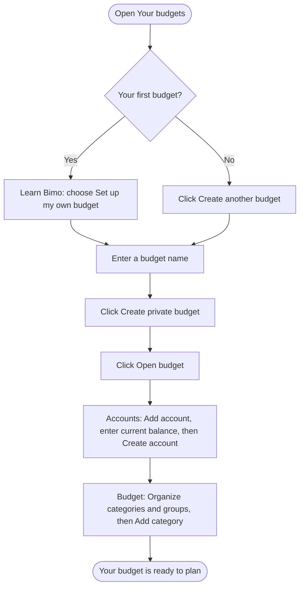
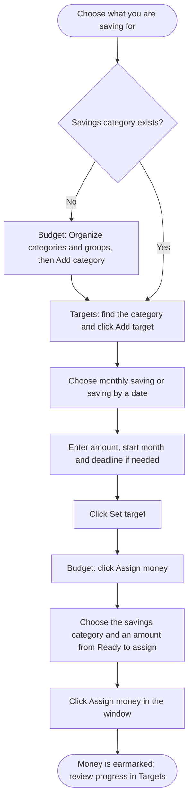
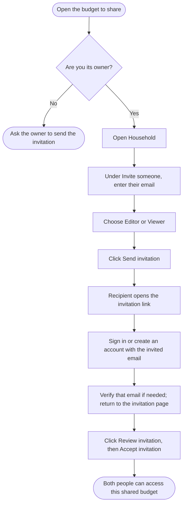
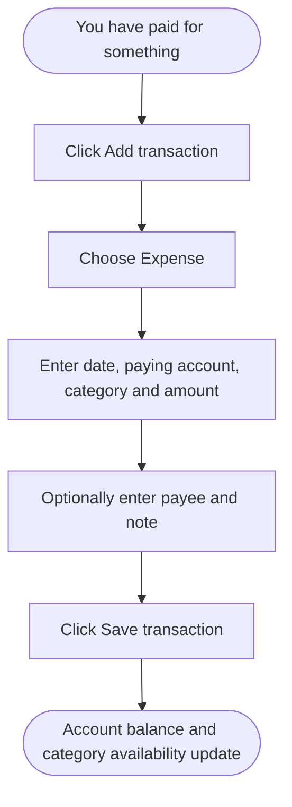
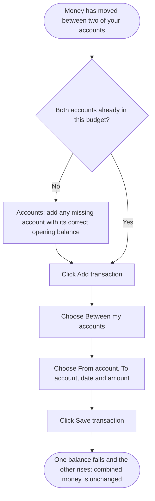
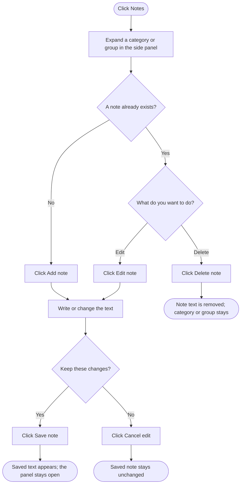

# Bimo task flowcharts

Checked against the current local application's screens and button names on 30 October 2026. Except for creating a budget, start signed in with the relevant budget open. Financial changes and note changes require owner/editor access. Only the owner can invite members.

## Create a budget

Current budgets use Nigerian naira and Africa/Lagos. Enter only money you already have as an opening balance; new budgets start without demo money.

## Save toward a goal

A target describes the goal. Assigning money funds its category. Neither step transfers money at a bank. Monthly targets measure this month's contributions; save-by-date targets measure current category availability. To move money between real accounts, make that transfer separately and record it using the transfer flow below. If a target already exists, use Edit target instead of Add target.

## Invite someone to a budget

Editors can change money and shared notes. Viewers can read and export. Only the owner manages access; other budgets remain private. Invitations expire after seven days. In the current preview, invitation emails go to the local Mailpit inbox; real inbox delivery is not configured.

## Record spending

Record the payment once. An expense records spending that has happened; it does not send a payment.

## Record a transfer between your accounts

Both accounts must be open and belong to the same budget. Use balances from before the recorded transfer, so it is not counted twice. Record a transfer fee separately as an expense. A payment to another person is an expense, rather than a transfer between your own accounts.

## Add, edit or delete a note

Owners/editors can add, edit and delete shared notes; viewers can read them. Deletion clears the current note and keeps audit history. Close the panel with its close button, Cancel, Escape or an outside click when no save is running.

## If a save is interrupted

The app shows a friendly message. While a request is running, wait for confirmation. If confirmation is uncertain, retry the same change; Bimo retains its original request/details while that page stays mounted. Do not assume a network error means the change was not saved. Reload/navigation does not preserve that client retry state.

## Source basis

These diagrams describe the implemented local workflows, checked against `app/page.tsx`, `app/setup/page.tsx`, `components/budget-setup.tsx`, `components/money-workspace.tsx`, `components/category-groups.tsx`, `components/savings-targets.tsx`, `components/household.tsx`, `components/invitation-review.tsx` and `components/budget-notes.tsx`. This documentation task did not change application code or execute financial operations.
