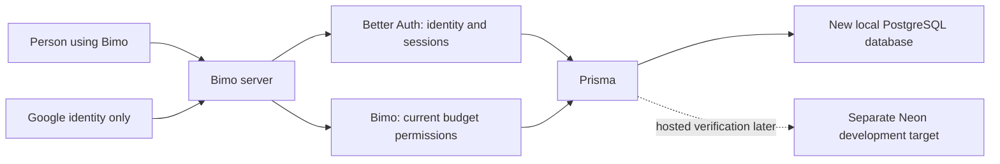

# BMO: product and modernization plan

Prepared 25 October 2026; updated 27 October 2026. The framework-upgrade increment is recorded in section 30. Section 31's approved database/Better Auth local foundation is implemented and checked in the separate `codex/database-auth-foundation` checkout; section 32 records the results and continuation path. The user explicitly postponed Neon/Google setup. Public deployment, real email delivery and changes to the old database remain outside this increment.

## 1. Product direction and decisions

BMO should help Nigerian individuals and households understand what they can spend, give their money a purpose, and keep an accurate record with little effort. Start with a dependable personal budgeting product, then add household collaboration and carefully controlled automation.

Confirmed requirements:

- Nigeria first; individuals and households are the initial audience. Public signup is confirmed on 26 October: participation is not limited to people the developer personally knows. Keep the initial active feedback cohort small through measured capacity; do not present it as a personal-use Gmail exception.
- Neon Free PostgreSQL is the selected hosted database, accessed through Prisma ORM. Convex is out of scope.
- Fresh start confirmed 26 October: existing database users, password hashes, budgets, transactions and other legacy rows do not need to be migrated. Design a new schema for the agreed release and begin with new signups and empty real budgets. This removes legacy-data compatibility requirements; it does not authorize deleting/resetting the old database or changing application code during planning. Preserve the old project/schema/migrations and before-capture evidence as references.
- Vercel Hobby is finalized as the website/backend host for the personal, non-commercial $0 feedback pilot. Begin with a free .vercel.app address and approximately 10 daily users. Cloudflare is parked as a later alternative; verify actual performance and allowances before public use.
- Confirmed Stage 0 simplifications (26 October): defer built-in chat and advanced credit/loan/investment workflows; replace the compulsory long questionnaire with short setup plus the interactive tutorial. Everyday budgeting, reports, targets, household sharing and optional Gmail reviewed drafts remain in the first release.

- Make the agreed features work reliably on desktop first. Standalone HTML visual explorations are authorized now; applying a chosen design to the application is a later step. The separately composed mobile experience follows the desktop feature milestone and is not a first-pilot release gate.
- Google sign-in comes first among social providers. Apple is a later possibility.
- First release includes optional Gmail connection and a review inbox for extracted bank-alert transaction drafts. The user approves drafts before they become transactions. Automatic posting and voice AI remain deferred.
- Better Auth is the selected replacement authentication system. Do not migrate to NextAuth 5 as an intermediate step. The existing NextAuth 4 received a compatibility patch during the framework upgrade in section 30; that does not change the Better Auth decision.
- Independent budgets are the initial ownership model: each budget owns its accounts, transactions, categories and memberships.
- Target five bank-alert formats for the first release, using redacted examples supplied by the user. Bank selection and parser details will be discussed later; unsupported formats remain unposted. This replaces the earlier three-format target.
- Email ingestion is optional and off by default. Google sign-in must never implicitly enable Gmail access or automatic financial-record updates.
- Operating cost for the feedback pilot must be $0. Paid plans, automatic paid overages and mandatory paid services are excluded. Optional features pause or fall back when free allowances are exhausted.
- Hosting and file-storage providers may change to satisfy the $0 requirement. Sentry is selected for crash/error reporting on its free Developer plan; PostHog remains optional product analytics. Use each only within its free allowance.
- Include a transactional welcome email in the first-release plan. The sending provider remains a recommendation: evaluate Brevo Free for the strict-$0 pilot without an existing domain, or Resend Free if a controlled sending domain is already available. See section 24; no provider account, subscription or integration is configured by this decision.

Confirmed names: references to “Better Off” and “independent widgets” in the discussion are understood as Better Auth and independent budgets from the decision list. The first framework implementation increment was explicitly requested on 26 October; subsequent features follow the milestones below.

The desktop pilot should prove that balances are correct, users can allocate and record money easily, and users retain control of information and automation. The later mobile interface will use the same financial operations and data. A registered-user count below 10,000 does not guarantee that any free tier can provide uninterrupted service; activity, storage and computation determine capacity.

## 2. What exists today

This inventory comes from the repository's routes, components, schema, configuration, and documentation. It identifies implemented surfaces and supporting models; it does not claim that every flow has been tested successfully. The earlier setup verified signup, sign-in, PostgreSQL migrations, and a socket connection. This planning review did not perform a complete behavioral or security test.

The repository has 37 API route modules and 19 Prisma models. Documentation sometimes describes capabilities more broadly than the implementation demonstrates.

| Area | Evidence in the app | Proposed treatment |
|---|---|---|
| Authentication | Email/password sign-in using NextAuth; custom registration, password change, forgot-password, OTP verification, and reset endpoints | Implement the new account lifecycle with Better Auth in the fresh database. Legacy user IDs/password-hash compatibility and account migration are no longer required. |
| Profile and account lifecycle | Profile editing, budget membership listing, plan management, account deletion and deletion warnings | Keep; require safe identity changes, data export, and clear deletion behavior |
| Onboarding | A long questionnaire, generated categories, personalized setup, and a blank-budget shortcut | Replace with a short setup; make personalization optional |
| Multiple budgets/plans | Create, select, edit, and delete plans; each has a currency and memberships | Keep; resolve inconsistent selected-plan behavior before launch |
| Budget worksheet | Month selection, category groups and categories, assigned/budgeted values, activity, available amounts, and money left to assign | Keep as the core; define and test the arithmetic |
| Category management | Rename, hide/show, move categories between groups, select multiple rows, bulk edit and delete | Keep useful operations; favor archive/reassignment over destructive history loss |
| Quick budgeting | Five template options, including 50/30/20 and pay-yourself-first, with allocation previews | Simplify; make classification explicit and user-editable |
| Goals/targets | Weekly, monthly, yearly, date-based, and custom target surfaces; category/group associations and progress fields | Keep a smaller, reliable set first; validate each supported goal type |
| Notes | Create, edit, and delete notes for categories or category groups | Keep; integrate into the relevant detail view |
| Financial accounts | Checking, savings, cash, credit and other asset/liability types; balances, institutions, on-budget/tracking distinction, closed accounts | Keep cash/bank/savings first; verify liability and tracking behavior before presenting advanced support |
| Transactions | Add, edit, delete; income, expense, transfer; payee, date, memo, category and account; search and account/category filters | Keep; highest priority for correctness and permissions |
| Transaction states | Schema contains cleared/reconciled status, approval, flag and import fields | Treat as partial capability until complete workflows are verified |
| Split transactions | Database model exists | Do not advertise as complete; implement and test deliberately |
| Reports | Monthly budget-versus-actual summaries, chart/list views, account/category filters, category/group aggregation and report CSV export | Keep; align every figure with the transaction ledger |
| Household collaboration | Invitations and acceptance, memberships, owner/editor/viewer roles, member management | Keep; present as Sharing or Household rather than enterprise-style Teams |
| Messaging | Team chat, reply/thread-related data, socket transport, message export, anonymization/retention and cleanup | Defer from the main launch experience; do not copy legacy chat records into the new database. Leave the legacy database unchanged during planning. |
| Real-time transport | Separate Express/Socket.IO process and a second socket implementation in the main codebase | Consolidate only if live collaboration is needed; authenticate every connection and room |
| Offline/PWA foundations | Manifest, some mobile metadata, Dexie dependency and SyncLog model | Full offline synchronization was not found wired into the inspected app; plan it as new work |
| Operational utilities | Debug routes, message-cleanup endpoint/script and development email fallback | Remove or strictly gate debug behavior for production; replace unsafe defaults |

Capabilities not found as complete user workflows include bank connectivity, bank-email ingestion, transaction CSV import, recurring transaction scheduling, a full reconciliation workflow, receipt attachments/OCR, voice control, PostHog instrumentation, a Cloudflare deployment configuration, and a distinct mobile interface. Report CSV export and message export already exist; a complete portable financial-data export still needs planning.

## 3. Release blockers found during inspection

These are specific static observations to turn into reproduction cases and fixes. They are not an exhaustive vulnerability report.

| Priority | Observation | Required outcome |
|---|---|---|
| Before public use | The transaction form submits an expense as a negative amount, while the account helper subtracts that signed amount. This appears to increase the account balance for an expense | One documented sign convention, verified with income, expense, transfer, edit and deletion examples |
| Before public use | Creating a transaction, adjusting accounts and updating budget activity are separate writes; helper failures are caught without failing the original operation | Each financial operation commits all effects together or none |
| Before public use | Transaction update/delete paths check membership in a supplied/default plan but retrieve the target transaction by ID without constraining it to that plan | Every target record and related account/category must be authorized in the same budget |
| Before public use | The separate socket server joins a group using a client-supplied group ID without session/membership verification | Authorized room membership enforced on the server, or live sockets withheld from launch |
| Before public use | Selected-plan behavior is inconsistent: the budgets endpoint deliberately uses the user's first plan for account totals, and the Teams page also selects the first membership | Decide whether plans are independent budgets or scenarios over shared accounts; use that model consistently |
| Before public use | OTP/invitation-related helpers use Math.random; the cleanup endpoint has a fallback shared secret; debug endpoints expose operational information | Reviewed token generation, expiration, attempt limits, required secrets, and production-safe diagnostics |
| Before public use | Installation reported vulnerable dependencies; no automated test script or test suite was found in the repository inspection | Review advisories, update affected packages deliberately, add meaningful financial and permission tests |
| During auth work | User.password is required in the current schema | Social-only accounts must work without fake passwords, and password checks must handle accounts without credentials |
| During redesign | Fixed-width sidebar and fixed left margin; page metadata disables browser zoom | Separate mobile composition, browser zoom, keyboard access and accessible controls |
| During localization | Onboarding includes dollar-denominated income ranges; formatting defaults use en-US even when currency defaults to NGN | Naira-first examples, locale-aware formatting and consistent dates |
| Before offline claims | Manifest refers to assets not found in the inspected public file list; a service-worker/sync flow was not found | Complete installability deliberately and distinguish cached views from reliable offline writes |
| Before scaling | Transaction retrieval loads all transactions without pagination | Bounded queries, appropriate indexes, paginated lists and measured report performance |

Primary repository evidence:

- [Transaction sign in the form](C:/Users/MasterMoh/bmo-budget-app/components/transactions/transaction-form.tsx:136).
- [Account-balance update helper](C:/Users/MasterMoh/bmo-budget-app/app/api/transactions/route.ts:68) and [transaction creation](C:/Users/MasterMoh/bmo-budget-app/app/api/transactions/route.ts:254).
- [Transaction update target lookup](C:/Users/MasterMoh/bmo-budget-app/app/api/transactions/[id]/route.ts:253).
- [Socket room entry](C:/Users/MasterMoh/bmo-budget-app/socket-server/server.js:35).
- [First-plan account-total selection](C:/Users/MasterMoh/bmo-budget-app/app/api/budgets/route.ts:89).
- [Fixed main layout](C:/Users/MasterMoh/bmo-budget-app/components/conditional-layout.tsx:45), [disabled zoom](C:/Users/MasterMoh/bmo-budget-app/app/layout.tsx:34), and [token generation](C:/Users/MasterMoh/bmo-budget-app/lib/email.ts:455).

## 4. Proposed architecture

Keep one application, one financial data model and one set of authorization rules. Separate presentation for mobile and desktop while sharing the domain operations, validation, permissions, data access and tests.

```text
Desktop web interface       Mobile web interface / PWA
              \             /
           Authorized application operations
          /             |                  \
Authentication      Budgeting engine      Import / assistant tools
          \             |                  /
                    Prisma
                       |
                Neon PostgreSQL

Application/API hosting: Vercel Hobby — finalized for the personal, non-commercial feedback pilot; no paid upgrade or paid usage authorized
Private files: a verified no-card free tier, or defer attachments; R2 is not mandatory
Sentry: redacted application errors
PostHog: optional, narrowly selected product analytics
Optional background processing: email ingestion, retries, reminders
```

Keep Prisma initially. A move from PostgreSQL to Neon does not justify replacing the ORM and rewriting every query. Modernize the runtime/client only where required by the selected Vercel/Neon integration, in a separate tested step. No Cloudflare runtime adaptation is part of the selected hosting path.

Rehearse the selected Vercel Hobby deployment with isolated data before public release. Test a real authenticated request, a database read, an atomic money operation, a Google callback and an email-provider call. Measure CPU time and cold starts. Prefer keeping Next.js on a suitable free Node.js hosting plan rather than undertaking a runtime rewrite solely to use Cloudflare. Vercel Hobby is the user-confirmed host for this personal, non-commercial feedback project; verify eligibility and usage limits before deployment. Exceeding a quota can pause service. [Vercel Hobby](https://vercel.com/docs/plans/hobby).

Cloudflare is parked as a possible later alternative, not a parallel first-release deployment. Its current documentation recommends vinext for Next.js applications and retains OpenNext as another documented path. Select the route after checking framework/version compatibility; do not add a framework rewrite merely to follow a tool default. A full Next.js server app cannot simply be uploaded as a static Pages site. [Cloudflare Next.js guide](https://developers.cloudflare.com/workers/framework-guides/web-apps/nextjs/).

Initially, use ordinary refresh/invalidation after writes and when returning to a screen. Avoid constant polling. If shared live editing proves valuable, choose one authenticated real-time implementation after measuring its cost. Neon hosting alone should not be assumed to provide the app's existing Socket.IO behavior.

## 5. Authentication decision: Better Auth selected

Decision recorded after the comparison below: migrate once to Better Auth. The NextAuth path is retained only as background, not as an implementation option still awaiting a decision.

### Previous alternative: retain NextAuth (not selected)

This is the smallest path to Google sign-in. The app already uses NextAuth v4, a Prisma adapter, JWT sessions and custom password endpoints. Google support is available in v4; adding it does not require a v5 migration. Passwordless email links can also be supported. Keep Google sign-in separate from permission to read a mailbox. [Google provider](https://next-auth.js.org/providers/google), [Auth.js email providers](https://authjs.dev/getting-started/authentication/email).

Work still required:

1. Select a maintained, patched version and review its compatibility. Treat a major-version upgrade as its own migration, not a prerequisite for Google.
2. Add Google OAuth configuration, exact local/production callback URLs and the sign-in UI.
3. Update the user schema for social-only accounts, without creating meaningless random passwords.
4. Define safe linking of an existing password account to Google. Require proof of account ownership; do not merge accounts based only on matching unverified email text.
5. Harden custom registration, email verification, password reset/change, throttling and session revocation.
6. Verify all session consumers, permissions, invitations and onboarding paths.

NextAuth's credentials provider authenticates against an existing credential system; it does not supply a complete registration and password-recovery service. The current app already implements that extra work itself. [Credentials provider](https://authjs.dev/getting-started/providers/credentials).

### Selected path: fresh Better Auth account lifecycle

The new database starts with new identities; there is no need to move NextAuth users, preserve legacy User IDs, import old password hashes or support legacy sessions. This supersedes the earlier additive auth/data migration proposal. Users register again in the new application. Safe linking of new Google and password identities still matters after launch.

1. Inventory current session checks, hooks, middleware, invitation checks and account-deletion dependencies so the application replacement is complete.
2. Pin compatible Better Auth, Prisma CLI/Client/driver and Node versions. Proposed implementation baseline: a supported, patched Prisma 7 release; exact versions must be verified before installation. Do not select a prerelease through an unpinned latest tag.
3. Generate/review the Better Auth models for the chosen configuration and integrate them into a fresh Prisma schema. Use Better Auth's core user/session/account/verification shapes; configure supported model/table mappings if giving auth tables clearer names.
4. Use Better Auth's documented password storage for new password accounts; Google-only identities need no fake password. No legacy bcrypt compatibility layer or hash backfill is required.
5. Google login uses identity scopes only. Optional Gmail access is a separate, revocable connection and must not silently share or expand the identity-login grant.
6. Implement verification, password reset/change, safe identity linking, logout, expiry, session revocation and user deletion with a validated free email path.
7. Test newly created password users, Google-only users, an account with both methods, invalid/expired tokens, revoked membership and an ordinary returning user of the new database.
8. Retire the old NextAuth application paths only in a later authorized implementation step with regression checks. Do not modify the old database/schema or discard the before archive as part of this planning edit.

Better Auth generates Prisma model definitions; Prisma creates/applies the database migrations. Authentication tables are framework-owned contracts, not tables to approximate by hand. [Better Auth Prisma adapter](https://better-auth.com/docs/adapters/prisma), [core database models](https://better-auth.com/docs/concepts/database).

The prior NextAuth comparison above is historical background. Better Auth is settled; there is no intermediate NextAuth upgrade planned. Apple remains deferred from the $0 pilot. The detailed proposed signup, session, recovery, household and Gmail flows are in section 27; its policy settings are recommendations, not newly confirmed user decisions.

## 6. Fresh Neon database and Prisma learning path

The user confirmed a fresh database on 26 October 2026. Retaining old rows is not a requirement. Build a new PostgreSQL schema for the agreed release rather than reproducing the old 19 models merely to preserve compatibility. Neon stores the database; Prisma describes and accesses it; Better Auth defines its own authentication-model requirements. The detailed proposed model is in section 26.

Implementation sequence, for later authorization:

1. Pin a compatible, patched Prisma/Client/driver/Better Auth/Node set. Prisma 7 is the proposed baseline because the current Neon and Better Auth integration guides target it; validate exact patches before implementation. Keep CLI, Client and Prisma driver majors aligned. Do not install unpinned latest or assume commands for a newer major are interchangeable.
2. Design/review the fresh schema and its invariants. Preserve the old schema and six migrations in history/archive, but do not automatically replay their legacy design into the new production database. Prepare a distinct initial migration history for the new version in the implementation branch.
3. Use local PostgreSQL for ordinary development. Create isolated Neon development/preview resources when a hosted rehearsal is authorized, and a separate empty production target for launch. Preview builds must never receive production credentials. A branch is not automatically free or a substitute for authorization checks.
4. Use the pooled Neon connection for Vercel application traffic and a direct connection for reviewed Prisma migration/admin tooling, with TLS and server-only secrets. Configure the Prisma 7 datasource/client through the correct adapter/configuration rather than copying the current Prisma 5 setup unchanged. Reuse the client across warm invocations. [Neon Prisma guide](https://neon.com/docs/guides/prisma).
5. Generate/review Better Auth's models alongside the application models. Create and inspect versioned SQL migrations; check foreign keys, money precision, unique constraints and indexes, including any reviewed SQL constraints not expressed by the Prisma schema.
6. On the proposed Prisma 7 workflow, create migrations in development with migrate dev, generate Prisma Client, and apply reviewed existing migration files to empty production with migrate deploy. Do not use db push, migrate reset or development migration commands as a production deployment strategy. Prisma's current top-level docs also describe a newer Prisma 8 prerelease workflow; use documentation matching the pinned major rather than mixing those commands. [Better Auth's Prisma 7 migration example](https://better-auth.com/docs/adapters/prisma), [Prisma migration-version distinction](https://www.prisma.io/docs/orm/migrations/applying-a-migration).
7. Seed only non-sensitive reference content and isolated synthetic test data. Do not seed real production users, demo balances, imported alerts or a default administrator. Start production with new signup, tutorial/practice data isolated from real budget records, and empty real budgets.
8. Recreate the schema from its migrations in a second empty development database; exercise financial/permission/auth tests and a restore rehearsal. No row-count comparison, ID preservation or old-to-new data transfer is required.
9. When implementation/deployment is separately authorized, launch the new app against the new database after tests. The old database can remain offline/unchanged as a reference; there is no requirement to connect its accounts to new identities. If it is deleted later, do that as an explicit separate action, not an implicit migration step.

No Neon resources, database tables, migrations, secrets, dependencies or application files were changed by this planning update. The old database has not been wiped. Once real users start entering records in the new database, their data must be preserved through reviewed migrations, reliable exports and tested backups. The user's permission to discard today's legacy data is not permission to reset future production data.

## 7. Financial correctness before automation

Create a small shared budgeting service used by manual entry, imports and voice tools. It should enforce:

- One documented transaction model: income, expense, own-account transfer, refund and adjustment. Keep signed amounts consistent throughout.
- Exact decimal money handling. The database already uses Decimal; stop converting money through floating-point arithmetic for authoritative calculations. Use decimal strings at API boundaries where appropriate and exact operations on the server.
- Explicit opening balances and recorded adjustments. Transaction history is the source for reconstructing balances; any stored totals must reconcile with it.
- Atomic updates to transactions, affected accounts, category activity and audit records. A failed operation must leave no partial financial effects.
- Repeated requests are safe: an operation/request key prevents duplicate posting after retries.
- All account/category/transaction references belong to the authorized budget, and the actor has the required role.
- Defined month rollover, overspending and backdated-edit behavior. Use explicit budget-month/date rules and Africa/Lagos for the first audience rather than relying on a hosting server's timezone.
- Clear treatment of credit cards, debt, refunds, fees, on-budget/tracking transfers and split transactions. Hide unsupported behavior until it has tests.
- Change history with undo or a corrective reversal. Protect concurrent edits from silently overwriting each other.

First tests: a ₦10,000 opening balance becomes ₦8,000 after a ₦2,000 expense; a ₦5,000 income then produces ₦13,000. Editing, deleting or retrying those operations produces the correct result exactly once. Transfers preserve combined money except explicit fees. A viewer and a member of a different budget cannot change any of these records.

The ownership decision is confirmed: each independent budget owns its accounts and transactions. If scenario worksheets over the same accounts are desired later, model scenarios explicitly rather than reading the first plan's balances implicitly.

## 8. Desktop and mobile design plan

Sequence confirmed: finish and validate the agreed desktop feature set first, applying the selected Canvas layout and Canvas light / Night desk dark themes during the authorized desktop implementation. Design the separate mobile experience afterward from those established workflows. The mobile proposals below are a later design brief, not a current implementation requirement. Keep domain operations independent of desktop layout so this does not require rebuilding the financial engine.

The mobile experience is a separate interface over shared behavior, not a shrunken desktop worksheet. Start as mobile web/PWA to avoid the cost and maintenance of native apps.

| Task | Desktop direction | Mobile direction |
|---|---|---|
| Understand today's position | Overview with money left to assign, overspending and recent activity | Compact home showing money available, items needing attention and a clear add action |
| Allocate money | Keyboard-friendly worksheet with aligned amounts and a selected-category detail panel | Category groups as a focused list; tap a category for amounts, activity, target and actions |
| Record spending | Fast dialog or inline entry with keyboard shortcuts | Thumb-friendly entry sheet: amount, account, category, payee/date; sensible defaults |
| Review transactions | Searchable, paginated table and useful bulk operations | Activity feed grouped by date; filters and full-screen transaction details |
| Review imports | Queue with source, match suggestions and side-by-side details | Review cards with clear approve, edit and dismiss actions |
| View accounts | Balance list plus selected account's transaction register | Account list followed by an account detail screen |
| Reports | Focused comparisons, filters and export | One insight at a time with expandable details; avoid miniature desktop charts |
| Sharing/settings | Dedicated settings areas | More/settings screens, reached without cluttering the main task flow |

Proposed phone navigation: Home, Budget, Activity and More, with a persistent Add action. Accounts and reports remain easy to reach; test their placement with actual users before finalizing it. Use the same URLs where practical so links and browser history work across device sizes. Load the appropriate composition without duplicating financial logic or fetching everything twice.

Design standards:

- Use the selected Canvas layout in both modes, Canvas light colours and Night desk dark colours, meaningful typography, consistent spacing and clear number hierarchy. See section 20 for the confirmed visual direction; individual screen details remain to be designed.
- English with Nigerian examples, naira as the initial default, local date/time expectations and user-editable categories. Include rent, transport, airtime/data, electricity, food, family support and irregular income where relevant.
- Keep one currency per budget initially. Merely storing a currency string is not sufficient multi-currency accounting; defer FX conversion until its rules are defined.
- Support small Android screens, iPhone Safari, slow connections, virtual keyboards and large text. Avoid unnecessary font/image downloads and heavy motion.
- Enable zoom, screen-reader labels, visible focus, keyboard navigation and sufficient touch targets. Never communicate budget health by color alone.
- Specify empty, loading, error, saving, unsaved, offline, no-permission and quota-limit states.
- Make the first encounter an interactive, game-style introduction that teaches through budgeting tasks. Keep real setup short (name/currency, initial account/balance and starter categories), offer clearly labeled practice money, and move the existing personalization questionnaire to an optional later step. See the household and tutorial proposal below.
- Add a hide-balances/privacy mode for use in public.
- Do not claim reliable offline editing until the sync, conflict, logout and device-data behavior is implemented and tested. Begin with clear connection status and recoverable drafts.

## 9. First-release scope and feature priorities

Updated 26 October 2026. The user wants to retain most useful existing features, remove unnecessary complexity and add a limited set of practical improvements. This is the consolidated working scope. Explicit user decisions are identified below; proposed simplifications and optional additions remain recommendations until agreed. Recording them does not authorize implementation or deletion.

### Core first-release checklist

| Area | First-release outcome | Status and limits |
|---|---|---|
| Signup and account recovery | Better Auth with Google and email/password, verification, reset/change password and secure sign-out; safe linking of new sign-in methods; new signup in the fresh database | Better Auth, Google and the complete account lifecycle are requested. Validate the free delivery path. Session expiry, revocation and token validation are required; do not assume every session must use a custom JWT. Apple remains deferred. |
| Independent personal/shared budgets | Create, rename and switch budgets; each owns its accounts, categories, transactions and members | Confirmed ownership model. Sharing a budget must not expose unrelated personal budgets. |
| Financial accounts | Bank/checking, savings and cash accounts; opening balances; editing details; closing accounts without losing history | Recommended reliable initial account set. Do not import legacy advanced-account records. Hide unsupported advanced workflows; once the new application has real users, preserve their financial history. |
| Monthly budget worksheet | Category groups, categories, assigned amounts, spending/activity, available balances and money left to assign; move category allocations and cover overspending | Core requirement; agree and test month rollover and historical edits. Moving allocations is different from moving money between real accounts. |
| Category management | Add, rename, reorder, move, hide/show and useful existing selection/bulk controls | Keep useful operations. Require reassignment or safe archival when a removed category has history. Hiding is organizational, not a privacy boundary. |
| Transactions | Add/edit/delete income, expense and transfer records; date, account, payee, category, memo; search and account/category filters | Core requirement. Refunds and recorded adjustments need explicit rules. Prevent duplicate retries and partial saves. |
| Financial correctness | Accurate balances and reports after opening balances, income, spending, transfers, refunds, edits, deletion, retries and month changes | Release gate. Use exact money operations, atomic saves, budget-scoped authorization and targeted tests. See sections 7, 22 and 23. |
| Savings targets | Monthly targets and save-an-amount-by-a-date targets with clear progress | Recommended smaller supported set. Defer more complex types until verified; legacy targets do not need migration. Preserve history entered after the new launch. |
| Budget notes | Add/edit notes for categories or groups | Keep. Viewer comments, if adopted, are separate from editing these shared notes. |
| Reports and exports | Trustworthy budget-versus-spending summaries, category/group views, chart/list views, filters and CSV report export; complete portable financial export | Reconcile figures with the ledger. Exclude transfers between budget accounts from spending. Currency labels must match the budget. |
| Household sharing | Individual logins, scoped invitations/acceptance, owner/editor/viewer roles, removal and protected ownership | First-release scope; permissions must pass before public sharing. Details and open recommendations are in section 21. Do not silently substitute a personal-only release. |
| Optional Gmail and draft review | Separate connect permission, pause/disconnect, extracted transaction drafts, corrections, approval/rejection and duplicate checks | Confirmed first-release scope. Five bank formats targeted; samples and bank names later. Off by default; nothing posts before approval. Resolve the compliant $0 path before public launch. |
| Guided introduction | Short setup and an interactive, skippable, replayable tutorial with isolated practice data; optional personalization | Interactive tutorial and replacing the compulsory 20-question questionnaire with short setup are confirmed. The user accepted the Stage 0 simplifications on 26 October. Keep personal progress separate from household setup. |
| Profile, privacy and reliability | Profile controls, ownership-safe account deletion, exports, restore-tested backups, understandable save/error states and Sentry crash/error reporting | Sentry selected on Free only, with redacted events and replay disabled initially. Monitoring must not block financial saves. The policy must describe actual data handling. |
| Welcome email | One helpful transactional welcome after successful account creation/verification, including Google signup; link to the tutorial and help | Requested addition. Send once per new account, not every login or linked identity. Brevo/Resend remain candidates, subject to free sender and delivery validation; see section 24. |
| Desktop experience | Canvas layout in both themes; Canvas light colours, Night desk dark colours; remembered theme; readable amounts, keyboard navigation, zoom and labelled controls | Visual direction confirmed. Implement the agreed desktop flows before the separate mobile composition. |

### Small practical additions to prioritise — proposed

- An uncategorized-transactions inbox, so missing categories are easy to resolve.
- Remember a payee's previous category as a suggestion, with a clear override; never silently override the user's chosen category.
- Basic balance checking against the user's bank statement, with explicit recorded corrections when needed. A complete advanced reconciliation workflow can follow.
- A short household change history showing who changed a financial record. Keep it free of raw email, credentials and unnecessary sensitive content.

These are recommended additions, not confirmed finished features or claims of trivial implementation. Replacing authentication in the app and adding Gmail integration are substantial workstreams and must be planned separately.

### Launch simplifications — confirmed and proposed

- **Confirmed 26 October:** replace the compulsory long questionnaire with short setup and guided practice. Optional personalization details remain to design.
- **Proposed:** keep Quick Budget but reduce overlapping templates to understandable suggestions, editable rules and a preview before applying; exact template reductions are not yet approved.
- **Confirmed 26 October:** defer built-in chat; its message export/retention surfaces follow that deferral. No legacy messages need to be imported. Keep category/group notes. Viewer comments and a new visible financial change-history screen remain separate proposed additions. Review socket consumers before retiring old messaging infrastructure.
- **Confirmed 26 October:** defer advanced credit, loan and investment workflows. Bank/savings/cash budgeting is the initial financial-account model. **Still proposed:** deferring split transactions and reducing advanced target variants; decide those details before the dependent feature milestone. No legacy import is required. Once live, preserve new users' records when changing feature scope.
- Gate/remove production debug utilities and unsupported product claims; consolidate duplicate session, selected-budget and socket approaches when implementing those areas.

### Later improvements

- Transaction CSV import with mapping, preview, duplicate detection and correction.
- Complete cleared/reconciled workflows, scheduled bills and recurring transactions.
- More detailed cash-flow/income-versus-spending reports and additional useful target types.
- Receipt attachments/OCR, advanced debt/investment tools and multi-currency accounting after their requirements are defined.
- Voice AI, speech commands and automatic email-derived posting remain deferred. Human-reviewed Gmail drafts stay in the first release.
- Apple/additional sign-in providers, full offline write synchronization and the separately composed mobile interface remain deferred.
- Analytics and hosted file services are optional; introduce only when needed and compatible with the $0 pilot.

Detailed free-hosting limits are intentionally parked for a later user discussion. The existing $0 spending constraint remains in force; no provider or paid upgrade is authorized by this scope.

## 10. Email-to-transaction roadmap

The detailed Gmail connection, review, privacy and free-launch working plan is in section 28. New policy recommendations there remain proposals.

This feature records what happened in BMO. It does not withdraw, send or otherwise move real bank money.

### Confirmed consent and setup requirements

- The app works without email access. Email transactions are optional, off by default, and unrelated to whether someone used Google or email/password to sign into BMO.
- A feature toggle or Connect Gmail button starts setup. It does not mark a mailbox connected, begin reading, or enable automatic posting before authorization succeeds.
- Show what BMO will read, how extracted details will be used, and which budget/account will receive entries. The user chooses a Google account and authorizes Gmail access on Google's own page. An existing Google session may avoid re-entering a password; separate authorization is still required when the permission has not already been granted.
- BMO never asks the user to enter or share their Gmail password in BMO. Bind the authorization callback to the signed-in BMO user and their explicit connection request.
- Request read-only Gmail access sufficient for extraction; do not request permission to send, edit or delete mail. Gmail read-only permission is mailbox-wide: bank-sender/label filters are BMO processing restrictions, not a guarantee that Google technically limits access to those messages. Explain that accurately before consent.
- After authorization, choose supported alert formats, destination budget/accounts and a start point. Default to future alerts; an older-history import requires an explicit range and preview.
- Connecting Gmail and automatically posting transactions are separate choices. Initially place extracted entries in a review queue. Later enable auto-posting only through an explicit opt-in for supported accounts/formats; ambiguous items continue to require review.
- Cancelling or denying access leaves the feature disconnected and the rest of BMO usable. Expired/revoked permission pauses syncing and asks the user to reconnect.
- Offer both Pause sync and Disconnect Gmail. Disconnect stops subscriptions/jobs, prevents pending jobs from posting, deletes stored mailbox tokens and requests revocation of the appropriate Google grant. Verify revocation boundaries so disconnecting a mailbox does not unexpectedly remove a separate Google login.
- Previously posted transactions remain budget records after disconnecting, with separate controls for removing imported records and retained source data. Never silently delete financial history because a connection was disabled.
- Gmail connection and human-reviewed extracted drafts are confirmed first-release scope. The $0 constraint remains binding: prove a compliant free authorization/verification path before public launch. If these requirements conflict, return the concrete tradeoff to the user; do not silently defer Gmail, promise it is free, or launch an unsuitable authorization mode. User-supplied alert import is a possible fallback requiring a product decision.

Google supports requesting additional permissions when a user activates a related feature rather than bundling them into initial sign-in. [Incremental authorization and revocation](https://developers.google.com/identity/protocols/oauth2/web-server#incrementalAuth), [Gmail permission scopes](https://developers.google.com/workspace/gmail/api/auth/scopes).

Delivery sequence for the first-release email work and later alternatives:

1. **Parser proof using user-supplied alerts:** paste alert text or import a small email file. Prove extraction for a few banks selected from the first users' needs. Use redacted fixtures, not private messages committed to source control.
2. **Later alternative, optional forwarding:** give users an individual ingestion address on a domain you control, with a revocable identifier and abuse controls. Cloudflare can process incoming email using Email Workers. A new custom domain has a cost if you do not already own one. Forwarding reduces the need for broad mailbox access, but still requires careful handling of financial messages. [Cloudflare email routing/processing](https://developers.cloudflare.com/email-service/).
3. **First-release optional Gmail connection and review inbox:** request access only when the user explicitly enables it; handle encrypted refresh tokens, disconnect/revocation, incremental sync, retries and expired subscriptions. Gmail push uses Google Cloud Pub/Sub rather than being a generic webhook. [Gmail push guide](https://developers.google.com/workspace/gmail/api/guides/push).

Google sign-in must not request mailbox access. Gmail reading scopes are restricted, and server storage/transmission of restricted data can require a security assessment. That work may conflict with a near-zero budget; resolve the permission and assessment path before committing to a public Gmail launch. [Gmail scopes and assessment requirements](https://developers.google.com/workspace/gmail/api/auth/scopes).

Processing pipeline:

```text
Receive -> validate source and size -> extract -> normalize -> match account
        -> detect duplicate/match existing transaction -> review
        -> one authorized atomic ledger operation -> audit and correction
```

Extract amount, NGN currency, debit/credit direction, transaction time, masked account, payee, reference and fees. Do not confuse an email's remaining balance with its transaction amount. Handle refunds, reversals and two alerts for a transfer between the user's own accounts.

Begin with explicit templates and validation. Use AI only for uncertain extraction if it improves measured accuracy. Email content is untrusted data; it cannot issue assistant instructions or authorize actions.

Prevent duplicates using both source IDs and normalized transaction references. Match manual/CSV entries as well as previously imported emails. Keep an import review queue and source/provenance on each posted entry. Repeated delivery or retry must not subtract money twice.

Launch with review required. Later, allow opt-in rules for proven formats/accounts, visible confidence reasons, a daily summary and easy correction. Unknown, spoofed, malformed or ambiguous alerts remain unposted. Sender-name matching alone is insufficient; account for email authentication and forwarding behavior. Keep raw message retention short and optional; delete mailbox tokens and retained message data according to the user's disconnect/deletion choices.

## 11. Voice assistant roadmap

Start with push-to-talk and a visible transcript. A continuous, interruptible voice conversation can follow after the basic experience is accurate and affordable.

Example tasks:

- “How much do I have left for transport?”
- “I spent two thousand naira on lunch from my cash account.”
- “Move five thousand from eating out to transport.”
- “Show my spending this month.”

Separate the technical stages: speech recognition -> interpreted intent -> authorized tool -> factual result -> optional spoken response. A single small model does not automatically solve all five.

First milestone: typed natural-language queries and commands. Second: short recorded speech and transcription. Third: speech output and conversational follow-up. This lets us test tool safety without debugging speech at the same time.

Allow a small set of structured tools: get category balance, summarize spending, propose a transaction, propose an allocation move, and apply a confirmed proposal. Every call is scoped by the server to the signed-in user's budget and role. The assistant receives only the minimum needed data; totals come from code/database queries rather than model arithmetic. No arbitrary SQL, shell commands or unrestricted database access.

For a write, show amount, currency, account/category and date before confirmation. Resolve ambiguous category names and “two k” before acting. Distinguish moving category allocations from making an actual bank transfer. Use request keys, audit records and undo/corrections exactly as manual entry does. Read-only answers can be immediate.

Evaluate a small hosted speech/model combination on Workers AI against device-assisted options. Choose using Nigerian accents, noisy rooms, naira amounts, category names, latency and cost per successful command. Keep a typed fallback and an editable transcript. Do not promise universal on-device support or free unlimited inference. Do not store recordings by default.

Workers AI currently has a 10,000-neuron daily free allocation; available models consume it at different rates. Use per-user limits, short clips and a global quota. A small model and a short context are preferred if they meet the accuracy bar. Model training and a vector database are unnecessary for the initial tool-based assistant. [Workers AI pricing](https://developers.cloudflare.com/workers-ai/platform/pricing/).

## 12. Storage, analytics and operations

**File storage:** R2 is an S3-compatible object store, but its subscription can bill beyond the included allowance, so it is not part of the strict-$0 pilot baseline. Evaluate Neon's included object storage as a no-card alternative; if access controls, availability or hard limits do not meet the requirements, defer attachments and generate downloadable exports without persistent file storage. Keep financial records in PostgreSQL. Any file service must use private buckets, owner/budget checks, authorized downloads, type/size restrictions and retention rules. Treat encrypted database backups as a separate access-controlled use case. [R2 setup and subscription](https://developers.cloudflare.com/r2/get-started/), [Neon Free inclusions](https://neon.com/pricing).

**Sentry:** Selected for first-release browser/server crash and error reports, grouped issues and release context, using the free Developer plan only. Redact event payloads, breadcrumbs and request context before transmission; do not include financial amounts, bank/email content, account numbers, credentials, cookies, auth headers, mailbox tokens or sensitive URL parameters. Leave session replay, profiling and broad log collection off initially. Limit noisy events and test quota exhaustion; reporting failure must not fail signup or financial saves. Verify source maps privately, a synthetic browser/server error and the privacy filters before launch. See section 24 for verified quotas and scope.

**PostHog:** Optional product analytics, separate from Sentry error reporting. Begin with selected events such as signup completed, first budget created, first transaction recorded, import reviewed and assistant command confirmed. Track activation, returning users, import correction rates and task failures. Do not send balances, amounts, email addresses, account numbers, merchant/memo text, bank messages or transcripts as event properties. Disable financial-page autocapture/session replay initially; mask and review any later use. Keep operational error reporting redacted too.

**Public readiness:** Test backups/restoration, privacy and deletion flows, API authorization, rate limiting, secrets, token encryption, dependency updates, audit logs and incident diagnosis. Review obligations for the chosen audience and financial/email data before launch; this document is not a legal compliance determination. Avoid account numbers where masked identifiers suffice.

## 13. Strict-$0 feedback-pilot plan

Decision: no spending for the feedback pilot. Use non-trial free plans without paid overages; do not add a billing method to obtain an optional feature. Switch providers, reduce scope or pause a feature rather than upgrade automatically. Published allowances were checked on 25 October 2026 and must be rechecked before implementation. Limits do not promise capacity for any particular registered-user count.

| Service | Initial approach | Cost boundary |
|---|---|---|
| Neon | Free project, sensible scale-to-zero, isolated development data | Pricing currently lists 1 GB database storage per project and 100 CU-hours per project; measure indexes, audit history, sessions and active compute as well as transaction rows |
| App hosting | Vercel Hobby is finalized for the eligible personal, non-commercial feedback pilot; use its free platform address initially | Validate the full app, auth, Neon connections and measured usage in a hosted rehearsal. Remain on Free; no paid upgrade or overage authorization. Cloudflare is parked as a later alternative |
| Cloudflare Workers | Optional Free-only alternative or small bounded service | Free limits include 100,000 requests/day and 10 ms CPU per request. If the app cannot fit safely, choose another free path; no Workers Paid upgrade |
| Better Auth core | Run the selected library within the app | No separate paid auth service required; hosting, database and email remain subject to their free limits |
| Files | Evaluate Neon's included 5 GB object storage; otherwise defer hosted attachments | Keep storage and egress within Free limits. R2 billing is excluded from the baseline |
| Sentry | Free Developer plan, error reporting only initially | Official pricing checked 26 October 2026 lists 5,000 errors/month and one dashboard user. That user is the developer, not an app-user cap. No paid plan, add-ons or paid usage; recheck quotas and exhausted-quota behaviour before activation |
| PostHog | No-card free plan with selected events | Currently 1 million analytics events/month; stop or sample optional analytics at limits |
| Transactional email | Provider pending: evaluate Brevo Free without an owned domain, or Resend Free if a controlled sending domain is already available | Checked 26 October 2026: Brevo 300 sends/day, Free branding and temporary sender-domain replacement; Resend 3,000/month and 100/day with a verified domain for real recipients. Quota covers welcome, verification, reset and invitation mail together. Validate account approval, sender eligibility and real delivery; no domain purchase or paid upgrade is authorized. Do not silently drop email/password recovery or household invitations |
| Voice AI | Opt-in, limited clips, strict shared quota | Workers AI free daily allowance is shared by users; unlimited voice is not a zero-cost promise |
| Apple sign-in | Exclude from the $0 baseline | Standard developer membership introduces an annual fee |
| Custom domain | Use a free platform subdomain | No domain purchase or renewal is required by the pilot. Forwarding on a custom domain is deferred unless one is already available without additional spending |
| Direct Gmail connection and review inbox | Confirmed first-release scope, off by default | Prove a compliant $0 path. If required verification/assessment cannot be met for free, bring the conflict back to the user before public launch; no silent scope reduction |

Sources: [Neon pricing](https://neon.com/pricing), [Vercel Hobby terms and limits](https://vercel.com/docs/plans/hobby), [Workers limits](https://developers.cloudflare.com/workers/platform/limits/), [R2 subscription](https://developers.cloudflare.com/r2/get-started/), [PostHog pricing](https://posthog.com/pricing), [Resend pricing](https://resend.com/pricing).

Do not weaken password hashing to fit a free CPU limit. Budget alerts are not hard spending caps. Use genuine free plans with provider-enforced limits, bounded jobs and app-side quotas. Reserve capacity for core budgeting and stop optional AI/import jobs before limits are exhausted. A hosting/database hard limit can still interrupt core service; a manual form cannot bypass a suspended backend. Never claim seamless availability after a provider has stopped service.

Illustrative scale calculations, not measured forecasts:

- 10,000 registered users with 1,000 daily active users making 20 API requests each means about 20,000 API requests/day. If all 10,000 are active, the same pattern is 200,000/day before other dynamic requests or jobs.
- 10,000 users adding 30 transactions/month creates 300,000 new rows/month. At an assumed 1 KB per transaction, that is about 300 MB/month before indexes, other models, backups and audit history; actual storage must be measured.
- A minute of voice for every active user can cost much more than ordinary form entry. Price speech recognition, interpretation and speech output separately.
- An always-active database can consume more compute than a lightly used one with the same registered-user count. Avoid scheduled keepalive traffic and unnecessary polling.

The spending commitment is $0 for the pilot; the availability commitment must match measured free capacity. Public signup is confirmed on 26 October, replacing the earlier invite-only recommendation. Begin with a small active feedback cohort, measure requests/storage/compute, and expand only while limits allow it. Any registration/admission cap is a capacity-control proposal and must be explained openly; it does not make public users personally known testers or exempt Gmail verification. There is no defensible guarantee of smooth free service for every workload below 10,000 users. If free capacity is exhausted, pause optional features or new invitations, export/preserve data where possible, and reassess free options with the user. Do not upgrade automatically, depend on temporary credits or create extra accounts to evade quotas.

## 14. Implementation sequence and completion gates

Updated 26 October 2026 in response to the request for a complete step-by-step approach. This replaces the earlier ordering in this section. It is a recommended implementation sequence, not authorization to start implementation or a claim that the stages have passed. Section 9 remains the release scope; sections 21–28 provide the detailed rules and open decisions.

Stage 0 scope/research deliverables are recorded in section 29, and the completed local framework increment is recorded in section 30. Public signup and feature simplifications are confirmed; provider launch gates remain open. Section 31's database/auth increment was approved on 27 October for local implementation; the credential-dependent Neon/Google checks were then explicitly postponed by the user.

### Where to start

Start with a short scope/readiness check, then build the fresh database and Better Auth as one foundation milestone. Design their contracts together: application records need a real user/owner identity, and authentication needs the correct tables. Define the minimum budgeting relationships at the same time so auth does not grow around a disposable user model. Implement the correct money operations immediately after that foundation.

The first useful end-to-end result is: a new person signs up, creates a private NGN budget, adds accounts and opening balances, records income and an expense, transfers money, signs out and returns to correct balances. Use a thin usable desktop interface for this proof. Reuse the selected Canvas direction as components are built; perform the complete visual integration/polish once the agreed desktop workflows are stable. Do not build every backend feature before giving the work a usable interface, and do not fully redesign screens still tied to obsolete money/auth behaviour.

Fresh Neon tables alone cannot fix the observed arithmetic defects. Replacing authentication alone cannot establish budget permissions. A visually finished interface cannot establish either property. The stages below deliberately prove those dependencies before optional ingestion and final presentation work rely on them.

### Ordered delivery stages

| Stage | Work and dependencies | Completion gate |
|---|---|---|
| 0. Close the release contract and check external blockers | Reconcile section 9 into a finite keep/improve/add/defer list; settle only decisions needed for the next stage. Confirm the first supported money/month rules. Investigate the compliant $0 Gmail path, essential verification/recovery/invitation email delivery, and selected Vercel/Neon eligibility/compatibility early. Review runtime/package compatibility and known dependency advisories. Preserve the existing source and before-capture evidence; do not repeat the entire capture merely to begin. | A reviewable release checklist, named unresolved blockers, first schema/permission rules and acceptance examples exist. No paid service is assumed. A Gmail/email cost conflict is visible before substantial dependent work; unaffected foundation work can proceed once authorized. |
| 1. Fresh database and shared contracts | The supported Next.js/React prerequisite is now checked locally (section 30). Implement the reviewed section 26 subset in an isolated empty development database. Section 31 starts with the auth/private-budget schema and identity checks; add accounts/categories and movement-ledger tables alongside their correct financial operations in stage 3. Add later feature tables through reviewed migrations when their contracts are ready. Separate local/test/preview/production targets and secrets. Generate Prisma Client, inspect migration SQL/constraints and recreate the schema from migrations. Preserve the old database/schema/history as references. | The new schema recreates cleanly, relations/uniqueness and budget boundaries work, and no legacy data or demo money is required. Database credentials are server-only. Do not rewrite migration history already applied to a database still in use. |
| 2. Better Auth and the first private budget | Build the section 27 lifecycle: Google identity-only sign-in, verified email/password, sessions, sign-out, password recovery/change and safe linking. Validate actual essential-email delivery; add the once-only welcome outbox/delivery path. Provide thin signup, short budget creation and an accessible signed-in shell. Establish server-side budget ownership/current-role checks now; shared-budget invitations come in stage 5. Add minimal safe error reporting/redaction early rather than logging sensitive auth data. | New Google-only and password users can return to their own budget; recovery and revocation work; verification/email failures are visible. No duplicate user/budget/welcome from retries; no fake passwords or implicit Gmail access. One user cannot access another user's private budget. |
| 3. Correct money engine and first usable budgeting flow | Implement exact amounts and shared authorized operations for opening balances, income, spending, internal transfers, refunds/corrections, editing and voiding/deleting under agreed rules. Include atomic writes, duplicate protection, audit attribution, stale-edit handling and consistent selected-budget access. Add the minimum account/category/transaction screens needed to use those operations. Rehearse this small flow on the selected host with isolated synthetic data once local checks pass. | The reference money scenario below passes through UI, server and database, survives reload/sign-in, and agrees with the report. A failed transfer leaves no partial movement. Duplicate retries do not double money, and unrelated/view-only users cannot write. Hosting/runtime/database compatibility is demonstrated for this slice before completing the full app. |
| 4. Complete everyday desktop budgeting | Expand the worksheet, assignment moves, overspending/rollover and historical-date behaviour; finish category controls, supported targets, notes, transaction search/filter/pagination, simple reports and NGN-correct CSV/portable exports. Simplify Quick Budget according to the accepted scope. Add proposed small improvements only after they are accepted. Each screen uses the same tested financial operations. | The accepted core section 9 checklist works through real desktop flows. Reports/export reconcile with the ledger; transfers are excluded from ordinary spending; month/date changes and safe account/category closure preserve history. Unsupported advanced workflows are not presented as complete. |
| 5. Household collaboration | Add owner/editor/viewer invitation, pending-list, accept/revoke/expiry, role changes/removal and ownership resolution, using the permissions already established. Test with distinct real browser sessions. Implement viewer comments or editor invitations of viewers only if those pending policies are agreed. Use ordinary refresh/invalidation first; do not make a permanent Socket.IO service a hidden release dependency. | Owners are protected; permitted editors can budget; viewers have no financial writes. Revoked access fails from already-open tabs and future background work. Other personal budgets remain private. Invitations list correctly and expire/retry safely. Approved history stays when a member leaves. |
| 6. Optional Gmail and reviewed transaction drafts | Proceed with actual OAuth access only after the applicable section 28 authorization/cost route is established. Select the five banks and obtain redacted format examples. Implement/test parsers against fixtures, then connect, account mapping, the agreed sync mode, draft review/edit/ignore/match/approve, duplicate/transfer/reversal handling, pause/disconnect and reconnect. Reuse stage 3 operations and stage 5 permissions. | Five selected formats meet their documented cases; unsupported/ambiguous mail stays unposted. Google login alone grants no mailbox access. Approval records money once; manual matches and transfer alerts do not double-count. Disconnect/removal stop future work. Public Gmail requirements and chosen sync costs fit $0. If blocked, continue unrelated stages, but do not silently drop Gmail from release or launch an unsuitable consent mode. |
| 7. Complete the desktop design and guided introduction | Integrate all accepted desktop flows into the selected Canvas layout with Canvas light and Night Desk dark colours. Finish consistent components, navigation, forms, empty/loading/error states, keyboard/zoom/accessibility, saved theme and NGN/date formatting. Replace the long compulsory onboarding with the accepted short setup and skippable/replayable game-like practice tutorial. Compare equivalent synthetic before/after journeys with screenshots. | All first-release desktop routes and primary actions have coherent finished layouts in both themes; new users can learn the actual product without altering real balances in practice. Gmail stays optional during setup. This stage completes the finite desktop scope; it does not wait for voice AI, advanced future features or a separate mobile composition. |
| 8. Release cleanup, privacy and recovery | Complete export, ownership-safe account deletion, agreed retention and restore-tested backups. Verify redacted Sentry browser/server reporting and safe email retries/quotas. Remove or gate obsolete/deferred UI/routes/services according to the accepted keep/defer list; remove old auth and duplicate paths after replacements pass. Review exposed debug utilities and affected dependency advisories. Draft privacy/help/support text from actual behaviour. | No obsolete path bypasses the new auth/money rules; sensitive tokens/mail/financial content are absent from diagnostic payloads. Export/deletion/restore are rehearsed. Retention and essential delivery policies are explicit. Deferred features are not advertised or accidentally accessible through old endpoints. Security/privacy controls also remain requirements throughout earlier stages. |
| 9. Full hosted rehearsal and release verification | Exercise the complete section 15 checklist on an isolated Vercel Hobby + Neon Free environment, including Google callbacks, real essential-email inbox delivery, household sessions and the authorized Gmail flow. Test representative Nigeria latency/slower connections, bounded reads, concurrency/retries, database wake-up and quota exhaustion. Review secrets, backup procedure, migration deployment and application rollback/forward-fix plan; old binaries must not be assumed compatible with a changed schema. | No known critical financial or permission defect; real delivery and provider requirements verified; free usage headroom measured for the intended pilot. Every blocker has passed or an explicit user-approved scope change is recorded. A provider accepting a request or a successful build alone does not count as end-to-end success. |
| 10. Small feedback pilot and first-release completion | Once the completed release is authorized for publishing, deploy the reviewed migrations to the empty production target and release without synthetic balances/default admin/legacy records. Start with the agreed small cohort, approximately 10 daily users, within measured capacity. Gather feedback, fix correctness/usability regressions, and compare usage with free allowances. | The complete agreed desktop release, including sharing and optional Gmail reviewed drafts, is available to the cohort; acceptance checks and deployment smoke checks pass, restore/recovery is usable, and important pilot defects are resolved. $0 is respected; exhausted optional services pause visibly rather than automatically buying capacity. User count alone is not a capacity guarantee. |
| 11. Distinct mobile experience after desktop | Choose the separate mobile composition using feedback from the working desktop product. Build phone-oriented navigation, worksheet/transaction entry, review and tutorial flows over the same authorized operations/data, then repeat relevant acceptance and accessibility checks on phones. | The agreed mobile milestone works as its own interface while showing the same correct finances as desktop. A native app or reliable offline writes are not implied by this stage. |
| 12. Deliberate later releases | Prioritize feedback before optional CSV import, advanced reconciliation, recurring/scheduled transactions, more reports/bank formats, attachments/storage, advanced accounts, Apple sign-in, analytics and voice AI. Automatic posting requires a separate explicit decision after draft safety is proven. Each feature must pass its own cost/privacy/correctness gate. | Each selected addition has a finite scope and measurable acceptance criteria. These ideas do not indefinitely block first-release completion or silently add paid services. |

### First end-to-end milestone and reference checks

Stages 1–3 together form the first meaningful implementation milestone. The result should be demonstrable in the browser, rather than only as new tables or helper functions:

1. Create a new verified user and an independent NGN budget; unrelated users cannot read it.
2. Add Everyday with NGN 50,000 and Savings with NGN 10,000 as opening balances.
3. Record NGN 5,000 income into Everyday, NGN 3,000 spending from Everyday and NGN 2,000 transferred from Everyday to Savings.
4. Final balances are Everyday NGN 50,000 and Savings NGN 12,000, combined NGN 62,000. Ordinary spending is NGN 3,000. Reloading and returning after sign-in preserve those results.
5. Assign NGN 5,000 to Groceries and record the NGN 3,000 grocery expense once: available is NGN 2,000 before separately defined rollover. Editing/voiding/refunds follow agreed rules through the same operation.
6. Force a failure during a transfer, retry a saved operation and attempt a cross-budget write: no partial transfer, duplicate money or unauthorized change survives.

Use the existing before-capture scenario as a regression reference. The old app's reversed movements and transfer-as-spending report must not be carried forward into the new implementation.

### How changes and parallel work should be organized

- Deliver one small, reviewable feature slice at a time, including its schema/operation/UI/checks. Keep the old baseline recoverable and avoid coupling unrelated framework, auth, financial, visual and optional-service changes into one large rewrite.
- Reuse safe existing components and selected design tokens as the new flows are built. Hide approved deferred navigation when replacing that area; remove implementation only after checking consumers, data effects and the accepted scope. Do not mechanically delete every old feature/table because a new database is planned.
- Define boundaries and shared contracts before parallel agents edit. When delegation is requested, focused inventories, synthetic fixtures and documentation can go to Luna; visual/browser tasks to Terra; integration/financial work to Sol; unusually difficult analysis/review can use Astra. Model selection and delegation are working recommendations, not an instruction to spawn agents or consume extra usage now. Keep responsibilities distinct and consolidate shared-file/migration edits through one owner.
- Add meaningful tests for money, authorization, migrations, parser variants, recovery and retries; use browser verification for journeys. Do not create a redundant test for every reversible wording/spacing change. Run the checks affected by each change, then complete the combined release rehearsal once the integrated behaviour is ready.
- Keep the master plan and release checklist current when a confirmed decision changes. Record test evidence and unresolved issues. Do not mark a stage complete merely because code exists or screenshots look correct.

### Decisions and blockers handled without losing momentum

Proposed scope reductions, finer household administration/comment rules, unresolved month/refund edge cases, Gmail sync/draft privacy/retention and the five bank examples remain explicit decisions. Resolve each before implementing the dependent behaviour. Gmail's compliant $0 path and essential account-email delivery should be investigated in stage 0, not discovered just before launch.

Unrelated local feature work can continue if a provider gate is pending. Public first-release readiness still requires all confirmed scope and section 15 checks; do not substitute Google-only login, personal-only budgets, a manual-only email replacement or a paid service without a recorded user decision. Hosting remains Vercel Hobby + Neon Free; the early experiment validates the selected stack rather than reopening the provider choice by default.

This roadmap defines a finishable first desktop release in stages 0–10, followed by the separate mobile milestone and optional improvements. No implementation, database provisioning/reset, dependency change, provider setup, deployment or subagent launch has been performed by this update.


## 15. First-release acceptance checklist

- Fresh password and Google-only users can register and return safely. Old database accounts/budgets are not imported; the new app starts with new signup. Google-only users do not receive fake passwords.
- A new empty database recreates from the reviewed new migration history and contains no synthetic/demo money. Repeat sign-in and all release checks against that new schema; table creation alone is not acceptance.
- Linking identities cannot take over an account. Logout, reset/change and revoked membership have the intended session effects.
- A ₦2,000 expense reduces the correct account by exactly ₦2,000 and updates the right category/month.
- Editing, deleting, retrying and transferring money preserve the documented totals; induced database failures leave no partial writes.
- Users cannot access another household's records by changing IDs. Viewers cannot change financial records through the UI, API, imports or assistant. If the proposed comment exception is accepted, allow only scoped comments and edits/deletion of the viewer's own comments.
- Switching budgets changes accounts, categories, reports and sharing consistently.
- Editors/viewers cannot remove or demote the owner. Removal revokes future requests from an already-open session; financial history stays. Validate any agreed ownership transfer before the owner leaves.
- Monthly/date-based targets, category notes, report exports and any accepted small additions meet the section 9 scope. Unsupported advanced flows are not presented as complete.
- For the desktop pilot, core tasks work on desktop. At the later mobile milestone, both interfaces show the same money and use the same authorized operations.
- Onboarding is short; slower devices and connections receive useful progress/error states; browser zoom and assistive navigation work.
- All important financial data can be exported; account deletion and backup restoration have been rehearsed.
- Analytics/logs and Sentry payloads omit sensitive content; secrets and mailbox tokens never reach the client. Synthetic browser/server errors appear in Sentry with usable release context; replay stays off and reporting failures do not affect financial operations.
- A new verified account receives at most one welcome email despite retries or linking Google later. Existing-user sign-in sends none. Validate bounce/suppression handling, bounded retries, quota handling and authentication-email priority without claiming delivery before the provider accepts a message; test real inbox delivery separately.
- Google sign-in alone grants no Gmail access. Denied/cancelled consent leaves imports off. First release requires manual review before posting; automatic posting is deferred. Pause/disconnect stops future reading/jobs without deleting financial history. Approved drafts post once, and ambiguous alerts require correction.
- Quota limits produce understandable fallback behavior, with the core manual budgeting path kept available wherever possible.

## 16. Remaining decisions and planned discussions

Confirmed: fresh Neon PostgreSQL database through Prisma without legacy-data migration; Vercel Hobby hosting; Better Auth; independent budgets; desktop first; Canvas layout with Canvas light / Night desk dark themes; optional Gmail with separate consent and human-reviewed drafts; five initial bank formats with selection/examples later; interactive tutorial; owner/editor/viewer financial permissions and revocation on removal; $0 pilot spending. Voice AI and automatic posting remain deferred.

1. Stage 0 now confirms public signup, chat/advanced credit/loan/investment deferral and short setup plus tutorial. Section 29 records the release snapshot. Small optional additions, exact Quick Budget/target variants and split-transaction scope remain to settle before their dependent stages. An existing UI/model is not proof of a completed feature.
2. Confirm the household recommendations in section 21: owner-only management of all memberships, viewer-only comments and accepted ownership transfer before the owner leaves. The user explicitly protects the owner and prohibits editor invitations of other editors; finer invitation permissions are not yet fully settled.
3. Section 22 now has the proposed cash-budget baseline and explicit acceptance examples. Implement and test those rules in the financial-core stage; negative opening/overdraft details, advanced reconciliation and any additional cases still need deliberate review. Advanced credit/debt workflows are deferred.
4. Later, choose five banks and provide redacted alert examples. Confirm drafts, transfer matching, reversals and duplicate handling for each format before claiming support.
5. Resolve the public Gmail verification/assessment route and genuine $0 essential-email sending recorded in section 29. Hosted performance, account eligibility, real sender delivery and usage exhaustion remain untested. Do not silently drop Gmail, email/password recovery or household sharing, and do not add paid services.
6. Define privacy/retention/deletion choices around the actual implementation and review applicable obligations before public use. Another product's policy is a reference, not Bimo's policy.
7. Public signup is confirmed; define transparent capacity controls around a small active pilot using measurements. Design the separate mobile interface after the desktop milestone; its final direction remains open.

No modernization implementation has been performed by this plan update. Several earlier static concerns were reproduced during the 26 October baseline capture (section 23); the remaining concerns still need validation. Hosted performance, free capacity, parser accuracy and voice accuracy remain unmeasured.

## 17. Isolated feasibility evidence

On 25 October 2026, a separate sample outside the BMO repository passed 13 local checks using Better Auth 1.7.13, Prisma 7.10.1, PostgreSQL 15 and Cloudflare's workerd runtime. A local deployment dry run also succeeded. The sample covered auth/session behavior, a simple atomic expense, rollback, a sequential duplicate request, invalid input, record isolation and preparation of a Google identity-only redirect using placeholder credentials.

This did not modify, migrate or test the existing BMO app. It used a disposable local database, not Neon. No public Worker or Google OAuth client was created; no real OAuth sign-in, hosted CPU measurement or full Next.js deployment was performed. The sample server and database were stopped afterward, while BMO's database remained healthy and the repository remained clean.

See the [feasibility report](C:/Users/MasterMoh/.codex/visualizations/2026/10/25/01a173e9-b493-7902-9acb-c6ccae4374e8/compatibility-report.md) for the evidence, a related upstream issue/fix and the next tests that can remain separate from the project.

## 18. Household sharing and interactive introduction

The user confirmed that BMO's first encounter should teach through an interactive tutorial, like the opening tutorial in a game: show what to click, explain its purpose, and let the person complete tasks such as adding a transaction. This is a functional requirement; Canvas light / Night desk dark is now selected for desktop (section 20). The separate mobile direction remains deferred.

Research of YNAB Together and a proposed BMO household model are saved in the [household and tutorial plan](C:/Users/MasterMoh/.codex/visualizations/2026/10/25/01a173e9-b493-7902-9acb-c6ccae4374e8/bmo-household-and-tutorial-plan.md). The proposed model shares individual budgets explicitly, keeps unrelated personal budgets private, and retains Owner / Editor / Viewer roles. The 26 October discussion confirms the core role boundaries, owner protection and loss of access on removal. Section 21 records the current rules and distinguishes the remaining recommendations; it supersedes the earlier draft decision status. The tutorial proposal uses the real controls with isolated practice money, short task-based lessons, and learning progress saved separately for each person.

This remains planning only. No household flow, tutorial, permission fix, database change or deployment has been implemented by this update.


## 19. Desktop concept exploration and updated release scope

The user authorized multiple separate plain HTML desktop concepts using Taste Skill, Impeccable and Playwright CLI. These studies do not change application code, dependencies, configuration or data. See [the concept gallery](C:/Users/MasterMoh/.codex/visualizations/2026/10/25/01a173e9-b493-7902-9acb-c6ccae4374e8/desktop-concepts/index.html) and [the companion first-release checklist](C:/Users/MasterMoh/.codex/visualizations/2026/10/25/01a173e9-b493-7902-9acb-c6ccae4374e8/desktop-concepts/release-scope.md) (synchronized with the canonical scope in section 9). The user subsequently selected Canvas layout with Canvas light colours and Night desk dark colours; see section 20. Gmail connection and human-reviewed extracted transaction drafts are confirmed for the first release; automatic posting and voice AI remain deferred.


## 20. Selected desktop visual direction

Confirmed 25 October 2026: Canvas is Bimo's main desktop look and layout in both themes. Light mode uses Canvas's cool blue framing and white work surface. Dark mode uses Night desk's neutral charcoal surfaces, warm white text and restrained amber data/focus accents. A switch changes appearance without changing layout or financial state; remember the user's last choice where browser storage is available.

The [combined HTML preview](C:/Users/MasterMoh/.codex/visualizations/2026/10/25/01a173e9-b493-7902-9acb-c6ccae4374e8/desktop-concepts/canvas-light-dark/index.html) demonstrates this decision across the budget, sample workflows and signup. The four original studies are preserved. Applying the direction to the actual application remains a later implementation step, and the separate mobile composition stays deferred.


## 21. Household rules from the 26 October discussion

**Confirmed by the user:** the owner can manage the budget; editors can do everyday budgeting but cannot add other editors; viewers can view without adding or editing financial information; neither editors nor viewers can remove the owner; a removed member must lose access. The user suggested that viewers might be able to add a note, without making that exception a final decision.

| Role | Financial work | Administration and notes |
|---|---|---|
| Owner | All supported budgeting actions | Manage memberships, protected ownership and budget closure/deletion, subject to the agreed safeguards. |
| Editor | Accounts, transactions, allocations, categories, targets and shared budget notes | Cannot remove/demote the owner or add editors. Recommended: keep all invitations, removals and role changes owner-only; whether editors can invite viewers still needs agreement. |
| Viewer | View accounts, transactions, targets, budget and reports; no financial writes | Proposed exception: separate comments only, with edit/delete rights over their own comments. Do not grant editing of shared financial/category notes. |

Recommended first model: one owner per budget. If additional administrators are introduced later, protect the original owner against removal/demotion; do not treat every administrator as an unprotected equivalent owner.

The user permits voluntary owner departure. Recommended safeguard: another member explicitly accepts ownership before that departure, or the owner deliberately resolves/closes the budget. Do not leave an active shared budget without an owner. Exact closure/recovery behaviour remains to be defined.

Removal revokes future website/API/import/assistant requests and any live-channel subscription. Recheck membership for authoritative operations; an open browser or unexpired login must not bypass removal. Clear sensitive local views where practical, while explaining that previously downloaded copies cannot be recalled. Keep financial records entered by departing members and appropriate attribution; leaving/removal must not erase household history.

Share each independent budget explicitly. Unrelated personal budgets stay private. An invitation explains what becomes visible; members use their own sign-in. Invite/accept/revoke/expiry and owner protection require server-side checks, not merely hidden buttons.

## 22. YNAB-informed everyday money rules

The user requests YNAB as a reference for everyday financial behaviour, adopting what makes sense for Bimo. This is not a request to copy every YNAB feature or its privacy policy. Research public documentation and build a case-by-case behaviour/test matrix before implementation; do not claim an exhaustive parity review is complete.

Rules supported by the documentation reviewed on 26 October:

- Income becomes money available to assign; ordinary spending reduces the selected category's available money. Refunds normally return to the original spending category. [Transactions and categories](https://support.ynab.com/en_us/getting-started-transactions-and-categories-SJejV3szx).
- A transfer between two cash accounts included in the budget stays inside that budget and is not spending. Transfers involving tracking/loan accounts or only one recorded account need separate treatment because money crosses the budget boundary. [Transfer transactions](https://support.ynab.com/transfer-transactions-a-guide-HJOsZz4Jj).
- Cash overspending and credit overspending differ: uncovered cash overspending reduces next month's money available to assign, while credit overspending represents debt without matching payment funds set aside. Adopt a complete credit-card model only when supported and tested. [Handling overspending](https://support.ynab.com/en_us/overspending-in-ynab-a-guide-ryWoxEyi).
- Closing an account preserves history. Bimo's account-closure flow must not silently remove or fabricate money. [Closing accounts](https://support.ynab.com/how-to-close-or-delete-an-account-in-ynab-ry_409Gko).

### Stage 0 financial baseline and acceptance examples

These are proposed implementation defaults and test oracles derived from the user's YNAB-informed cash-budget direction, not a claim that all edge policies were individually approved or that the application already passes. Advanced credit/loan/investment workflows are now deferred. Implement exact ledger operations and verify the first cases before adding more account types. Each row starts from its own stated setup unless it explicitly continues the prior row. Amounts are NGN; no currency conversion is implied.

| ID | Setup and action | Expected result |
|---|---|---|
| M01 Opening balance | Start a new cash/bank account with 10,000 | Account 10,000; money available to assign increases by 10,000. Opening money is identified separately from earned income in reports. |
| M02 Income | Account 10,000; receive 5,000 | Account 15,000; available-to-assign increases by 5,000; earned income 5,000. |
| M03 Expense | Account 10,000; Groceries has 5,000 available; spend 3,000 there | Account 7,000; Groceries 2,000; net grocery spending 3,000. Assigning money does not itself change the bank balance. |
| M04 Own-account transfer | Everyday 10,000, Savings 2,000; move 1,000 between them | Everyday 9,000, Savings 3,000; combined 12,000; spending/income and category allocations unchanged. Both accounts belong to the same budget. |
| M05 Category allocation move | Groceries available 5,000, Transport 2,000; move 1,000 Groceries to Transport | Availability 4,000 and 3,000; combined allocation unchanged; bank balances and spending unchanged. This is not a bank transfer. |
| M06 Transfer fee | Use the M04 starting balances; transfer 1,000 and record a separate 50 fee from Everyday | Everyday 8,950, Savings 3,000; total 11,950; spending 50 in the chosen fee category. |
| M07 Refund | Continue M03; receive a 1,000 refund to the same account/category | Account 8,000; Groceries 3,000; net spending 2,000; ordinary earned income unchanged. |
| M08 Cross-month refund | After M03, next month has no new assignments/spending; then refund 1,000 | Account 8,000; carried Groceries 2,000 becomes 3,000 in the refund month. Refund is dated when received; the original purchase remains in its original month. |
| M09 Edit expense | From M03, change the one expense from 3,000 to 2,500 | Account 7,500; Groceries 2,500; spending 2,500. Preserve record identity/audit; no second expense. |
| M10 Void/delete correction | Void M03's 3,000 expense through the agreed audited operation | Account 10,000; Groceries 5,000; effective spending 0. Every read/report excludes the voided effect consistently. Exact irreversible deletion/retention remains a privacy decision. |
| M11 Repeat/retry | Submit M03 twice with the same operation key and request | One expense; results remain 7,000 account and 2,000 category. Reusing the key with different inputs is rejected. |
| M12 Failed transfer | Starting from M04's setup, force failure between the two sides | Everyday remains 10,000 and Savings 2,000; no completed transfer or partial account movement survives. |
| M13 Positive rollover | Opening 10,000, assign 5,000 Groceries, spend 3,000; then start a month with no new activity | Bank remains 7,000; category carries 2,000; new month's assigned amount starts at 0; remaining unassigned 5,000 carries once. |
| M14 Uncovered cash overspending | Opening 10,000, assign 5,000, spend 6,000; then start a month with no new activity | Current category -1,000 is visible; account 4,000. Next month's category starts at 0 and available-to-assign is 4,000 after deducting the prior 1,000 shortfall once. |
| M15 Cover overspending | Before rollover in M14, assign another 1,000 from available-to-assign | Category becomes 0; unassigned falls from 5,000 to 4,000; bank unchanged. Next month must not deduct the covered shortfall again. |
| M16 Backdated change | Continue M13 into next month; correct the old expense to 2,500 | Effective account becomes 7,500; carried category becomes 2,500. Recompute following months; do not add a duplicated carry-forward record. |
| M17 Future assignment | Have 10,000 unassigned cash; reserve 3,000 for a future month | Bank remains 10,000; the 3,000 is reserved once, leaving 7,000 unassigned. Future expected income is not treated as received money. Cross-month display rules must preserve this invariant. |
| M18 External payment | Pay another person 1,000 from a 10,000 account | Account 9,000 and categorized spending 1,000; a bank's word transfer does not make it an internal transfer between two Bimo-owned accounts. |
| M19 Exact amounts/date | From 10.00, spend 0.10 and 0.20; separately enter date 2026-10-31 | Remaining 9.70 exactly. Reject unsupported fractional precision. The calendar transaction date stays October 31 in the budget's Africa/Lagos context. |
| M20 Closure/archive | Close an account or hide a category containing history | History and reports stay intact. A nonzero account must be explicitly resolved before closure; no silent balance erasure. Archived references cannot accept incompatible new operations. |

The opening-balance/report classification, operation identity, exact precision/date checks, future-reservation invariant and closure guard are explicit Bimo design recommendations. The core income/spending/refund treatment follows [YNAB's transaction/category guide](https://support.ynab.com/en_us/getting-started-transactions-and-categories-SJejV3szx) and [inflow/refund guide](https://support.ynab.com/en_us/how-to-add-income-and-other-inflows-H1ZNjfZJi). Rollover examples adapt the cash rules in [YNAB's month rollover guide](https://support.ynab.com/en_us/when-the-month-rolls-over-a-guide-rkyyd6qC9); historical changes follow its [plan troubleshooting explanation](https://support.ynab.com/en_us/troubleshooting-your-plan-r19HPofJo). These examples are a test contract, not application test results or complete YNAB parity.

Additional first checks: reject cross-budget account/category/payee references; viewers and removed members cannot post/edit; stale concurrent edits cannot silently overwrite a newer version; paired Gmail/manual records post once. Full acceptance still follows sections 15, 26–28.

Still to resolve before exposing the relevant workflow: negative opening balances/overdraft presentation, detailed target variants, full reconciliation, split-transaction inclusion and any future advanced account model. Do not suppress a real recorded cash expense merely because its category is overspent. Broad CSV import and scheduled occurrences remain later work.


Privacy and reliability must follow Bimo's actual data handling. Document identity/profile data, financial records, household visibility, Gmail permissions/tokens, extracted drafts, retention, disconnect/deletion, exports, backups and diagnostics. Use other products to identify questions; write Bimo's policy from the answers. Policy text does not replace working access controls, deletion or restore procedures.

## 23. Existing-app before capture and release blockers

On 26 October 2026, Playwright CLI exercised the existing app at commit `4e61a930b67e70e7e8264a1e90f5b66b22be3fb8`, using synthetic local users and records. The archive has 93 original screenshots, all 20 onboarding questions and six recordings; it covers every application page route, representative financial actions, category notes, target preview, reports/export and shared-budget joining. Application code, dependencies, lockfiles and configuration were preserved.

Evidence: [capture gallery](C:/Users/MasterMoh/.codex/visualizations/2026/10/25/01a173e9-b493-7902-9acb-c6ccae4374e8/before-2026-10-26/index.html), [capture notes](C:/Users/MasterMoh/.codex/visualizations/2026/10/25/01a173e9-b493-7902-9acb-c6ccae4374e8/before-2026-10-26/CAPTURE-NOTES.md), [manifest](C:/Users/MasterMoh/.codex/visualizations/2026/10/25/01a173e9-b493-7902-9acb-c6ccae4374e8/before-2026-10-26/manifest.json), [balance delta checks](C:/Users/MasterMoh/.codex/visualizations/2026/10/25/01a173e9-b493-7902-9acb-c6ccae4374e8/before-2026-10-26/checks/delta-analysis.json) and [portable archive](C:/Users/MasterMoh/.codex/visualizations/2026/10/25/01a173e9-b493-7902-9acb-c6ccae4374e8/Bimo-before-2026-10-26.zip). This is a development baseline, not a production load/security test or proof that every feature works.

| Observed issue | Required first-release result |
|---|---|
| NGN 5,000 income reduced the account; NGN 3,000 expense increased it; NGN 2,000 transfer moved both balances backwards | Implement one consistent money model in the new schema and test the complete transaction lifecycle. A fresh database alone does not fix the old arithmetic defect. For opening balances of Everyday 50,000 and Savings 10,000, followed by income 5,000, expense 3,000 and transfer 2,000 Everyday → Savings, final balances must be 50,000 and 12,000, total 62,000. The old app produced 50,000 and 8,000. |
| Connected chat message did not appear or persist | Preserve the evidence and existing messages; defer chat from the launch experience as proposed, rather than advertising reliable messaging. |
| Invitation send and acceptance succeeded, but the pending-list endpoint returned HTTP 500 | Retain sharing scope and implement/test the invitation lifecycle/list against the new schema. Both test users could view membership and the editor could select the shared budget. |
| Report counted the 2,000 internal transfer as spending; CSV summary used dollar symbols in an NGN budget | Report spending must be 3,000 for this scenario, with matching NGN labels and consistent ledger totals. |

The first grocery-category automation selected Rent before the search finished. That was a test-driver timing error, corrected through the app's Edit Transaction flow and documented in the capture notes; it is not evidence of an application categorization bug. Password recovery was captured through code entry; real inbox delivery and complete recovery were not verified. Unsupported/untested workflows must not be labelled as passed based on screenshots alone.

This update changes planning documents only. It does not implement the redesign, migrations, authentication replacement, permissions, fixes, Gmail integration or hosting.


## 24. Sentry crash reporting and free transactional email

Added 26 October 2026. **Confirmed request:** include Sentry for crash reports and a free, reliable way to send welcome emails. **Provider decision pending:** the email candidates below are recommendations, not configured services. This remains planning only; no accounts, API keys, SDKs, mail sends, subscriptions or application edits are created by this update.

### Sentry — selected

Use the hosted Free Developer plan for browser JavaScript errors, server exceptions, grouped issues and email alerts. Official pricing currently lists 5,000 error events per month and one dashboard user. The one-user limit applies to access to Sentry, not the number of people using Bimo. A recurring bug can consume many events. Recheck the actual account's plan/quotas before activation; do not treat a temporary Business trial or extra paid features as the baseline. [Sentry pricing](https://sentry.io/pricing/), [Developer plan membership](https://www.sentry.help/en/articles/13965060-how-do-i-cancel-my-subscription).

Start with error monitoring only. Leave session replay, profiling, broad logs and paid AI tools off. Use a narrow event-data policy and scrub financial values, emails, raw bank alerts, memos, account numbers, request bodies, cookies, auth headers, passwords, reset/invitation URL tokens and Gmail credentials from events and breadcrumbs. Use non-sensitive internal identifiers only where needed. Upload usable source maps through a private build credential and verify access; never put that credential in browser code. Test a synthetic error on both sides and inspect the actual submitted event for leaks.

Do not send the same errors to PostHog by default. PostHog remains a later/optional product-usage tool. Keep reporting out of the financial operation's success condition. Filter known noise, bound reporting and accept a monitoring gap at the free quota rather than introducing charges. Verify provider quota behaviour and avoid a billing method or paid usage. These are implementation requirements, not a claim that current Bimo is instrumented.

### Email candidates — researched, not selected

Stage 0 update: section 29 rechecks the no-owned-domain constraint. Brevo remains conditional: its SMTP setup requires domain authentication while its fallback documentation calls sender replacement temporary. Resend still needs a verified owned domain for real recipients. SMTP2GO was also checked and does not solve this user's account-signup constraint. No provider is selected or guaranteed by the allowance table.

| Candidate | Free allowance checked 26 October 2026 | Sender requirements and fit |
|---|---|---|
| Brevo Free | 300 sends/day; no plan time limit or credit-card requirement; Free emails carry Brevo branding | First candidate to test if the pilot has no owned domain. Brevo documents temporarily rewriting unauthenticated/free-address sender domains to its brevosend.com domain. That is a provider fallback, not a Bimo-owned address or a permanent entitlement. Validate account approval, allowed transactional sending, sender verification and real mailbox delivery. |
| Resend Free | 3,000 emails/month, also capped at 100/day | Suitable candidate when a domain with DNS control is already available at no extra cost. Real-recipient delivery requires a verified sending domain; the shared test sender is restricted to the account owner's address. A free app-hosting subdomain does not automatically grant the required DNS control. |

Sources: [Brevo Free limits](https://help.brevo.com/hc/en-us/articles/208580669-FAQs-What-are-the-limits-of-the-Free-plan), [Brevo plans/no-card terms](https://help.brevo.com/hc/en-us/articles/208589409-About-Brevo-s-pricing-plans), [Brevo sender-domain replacement](https://help.brevo.com/hc/en-us/articles/16045394674066-Troubleshooting-Domain-authentication), [Resend pricing](https://resend.com/pricing), [Resend verified domains](https://resend.com/docs/dashboard/domains/introduction), [Resend testing restrictions and quota errors](https://resend.com/docs/api-reference/errors).

No provider guarantees that every message lands in the inbox. Assess reliability using actual signup/verification, reset, invitation and welcome delivery to representative Gmail, Outlook and Yahoo accounts, including spam placement and sender appearance. The earlier Ethereal/local test capture did not establish real-user delivery. A controlled, authenticated sending domain is the preferred long-term arrangement, but a new purchase is outside the $0 budget unless separately agreed.

### Welcome and essential-email behaviour

- Use one sending integration for transactional welcome, verification, password resets and invitations where practical. Their combined messages share the provider's quota; the number of registered users alone does not determine email usage.
- Send a welcome once after a new account is verified/usable, including a new Google account; linking Google to an existing account or signing in again must not send another welcome. Include a short introduction, tutorial link and help information. No balances, account numbers or bank-alert content in the message, and no automatic marketing/newsletter enrolment.
- Keep the welcome optional to the success of signup: save account creation reliably, record the intended send and retry safely without duplicates. A failed welcome must not prevent a person from budgeting.
- Prioritise verification, recovery and invitation emails over nonessential welcome mail within application sending limits. Apply bounded retries and backoff; do not resend expired recovery links/codes from a long queue. Handle bounces, complaints and suppression, and keep delivery logs redacted. Provider acceptance is distinct from inbox delivery.
- Turn off open/click tracking for sensitive authentication messages. Keep secrets server-side and use only the permissions needed for sending. Outbound welcome/auth mail must not rely on a user's optional Gmail-reading connection or request Gmail send permission.
- At limits, defer nonessential messages, explain essential-send failures and preserve account/financial data; do not auto-upgrade, buy a domain or silently change the agreed login feature set.

Updated user answer: there is no owned domain. A controlled custom domain will be considered later, ideally free; no suitable free owned-domain path is verified or promised. The user prefers connecting Resend once that domain is available. Use a free platform web address for the pilot, which is separate from an authenticated email-sending domain. Brevo remains only a possible interim candidate if essential account email is needed before the domain decision. Do not silently remove first-release recovery/verification requirements; validate a free sending path or bring the conflict back. No email service is configured.


## 25. Finalized hosting: Vercel Hobby + Neon Free

Updated 26 October 2026. The user wants a small group to use Bimo every day smoothly at $0. No owned domain is available; obtaining a controlled domain and connecting Resend can be discussed later. The user has finalized Vercel Hobby as the application/backend host, with Neon Free PostgreSQL as the database. This supersedes the earlier Cloudflare-first experiment and provisional host comparisons. Cloudflare is parked as a later alternative. The decision updates the plan; it does not authorize deployment, paid usage or application changes.

### Confirmed hosting architecture

| Part | Selected approach | Status |
|---|---|---|
| Next.js application/API | Vercel Hobby | User-confirmed choice for the personal, non-commercial pilot; validate eligibility and the real deployment before public use. No paid plan or automatic upgrade. |
| Financial database | Fresh Neon Free PostgreSQL schema through Prisma with Better Auth integration | Confirmed fresh start; no old-user, password or financial-data import. Cloud connectivity, pooling and wake-up still need testing. |
| Public web address | Vercel-provided .vercel.app address initially | No domain purchase needed for website access. This does not provide the DNS control needed to verify a Resend sending domain. |
| Error reporting | Sentry Free | Selected, subject to the privacy and quota requirements in section 24. |
| Transactional email | Resend later when a suitable sending domain is available; interim provider unresolved | Essential verification/recovery/invitations must still work before public use; welcome delivery can be delayed without blocking budgeting. |
| Optional background work | Bounded draft ingestion, without continuous polling or a permanent socket process for deferred chat | Frequency, scheduling, Gmail permissions and free capacity remain evidence gates. Do not claim recurring/background work is solved by ordinary API hosting. |

### Current free allowances and trade-offs

- Vercel Hobby currently includes 1 million function invocations, 1 million CDN requests, 4 active CPU-hours and 360 provisioned-memory GB-hours in its usage window, plus transfer limits. These are separate meters, not a user-count guarantee. Hobby is for personal, non-commercial use; exhausted allowances can pause features. [Official Hobby plan](https://vercel.com/docs/plans/hobby).
- Cloudflare Workers Free currently allows 100,000 dynamic requests/day with 10 ms CPU per invocation. Direct static-asset delivery is free/unlimited, but invoking the Worker for SSR/auth/API work uses the dynamic allowance. Password hashing, rendering and parsing must be measured against the CPU limit without weakening security. [Workers limits](https://developers.cloudflare.com/workers/platform/limits/), [static-asset billing](https://developers.cloudflare.com/workers/static-assets/billing-and-limitations/).
- Neon Free currently includes 100 CU-hours/project/month, 1 GB/project storage and 5 GB/project public transfer. Idle compute sleeps after five minutes; querying wakes it, typically within a few hundred milliseconds according to Neon. At a fixed 0.25 CU, 12 active hours/day for 30 days consumes 90 CU-hours; 24 hours/day consumes 180. This arithmetic is illustrative, not Bimo measurement. Queries, background sync and autoscaling affect real usage. [Neon plans](https://neon.com/docs/introduction/plans), [scale to zero](https://neon.com/docs/introduction/scale-to-zero).

A small registered-user count does not prevent a CPU spike, noisy background job, database staying awake or storage exhaustion. No free plan or host selection guarantees zero outages. Measure requests, CPU, memory, transfer, database active time and storage together. Monitoring requests must not query the database simply to keep it warm.

### Why Vercel was selected and what still needs testing

Bimo's inspected baseline used Next.js 14 and Prisma 5. The framework is now Next.js 16.4.3, with Prisma 5 retained until the separate fresh-schema milestone; section 30 records local build/browser evidence. Reusing an appropriate standard Next.js runtime is a smaller deployment change than assuming compatibility with an alternative runtime. The earlier isolated Better Auth/Prisma Worker sample passed 13 local checks, not a hosted Cloudflare CPU test or the complete Bimo build; preserve that distinction. Vercel Hobby is now the selected path. Retain the Cloudflare evidence for a possible later reassessment; changing hosts requires a new product decision, not an automatic switch.

The currently configured vercel-build script runs prisma db push. During future authorized deployment work, replace that release process with reviewed migration deployment for the new schema and a production build; do not deploy with unreviewed schema pushes. This planning note does not change scripts or run migrations.

### Make normal daily use efficient

- Reuse loaded profile, session and budget data for navigation; refresh affected data after saves and when relevant shared data changes. Verify membership for authoritative operations even when navigation is cached.
- Fetch transactions in bounded pages, use suitable indexes and scope every query by budget. Avoid loading years of history to show the current month.
- Return confirmed save results to the interface without needless full-page reloads. Detect stale edits and prevent duplicate submissions; never display an unsaved financial record as safely stored.
- Keep static files cacheable. Do not put private financial responses into a shared/public cache; freshness and isolation are requirements.
- Place application compute near the database where the provider permits it; measure the end-to-end result from Nigeria. A nearby edge location alone does not settle database latency.
- Avoid permanent chat infrastructure and aggressive automatic refresh for the first release. Gmail draft ingestion must have bounded processing and tested scheduling/quota behaviour; a user-triggered refresh is a possible design to discuss, not a silently substituted first-release feature.
- Do not add Redis merely to reduce a headline request count. Introduce another service only if measurements justify the complexity and its free limits fit.

### Proposed rehearsal and rollout

1. Keep production deployment unapproved while planning. Use isolated synthetic data for a future hosted rehearsal; preserve the existing app/database and before archive.
2. Test real password signup/sign-in and Google callbacks, a secure session, budget loading, transaction save/edit/delete, transfer, duplicate retry, household removal and report totals. Test actual email separately. The known balance/permission defects must be fixed before inviting real users.
3. Measure a cold first visit, warm repeated visits and typical household activity from Nigeria. Proposed usability targets to validate: ordinary warm financial saves around one second or less and initial budget use within a few seconds on a reasonable connection; these are targets, not promises.
4. Start with approximately 10 daily users, as discussed, and expand gradually after observing actual behaviour. These are rollout sizes, not verified capacity limits. Measure simultaneous activity as well as unique users.
5. Run bounded synthetic concurrency checks and inspect CPU/memory/database usage; project monthly usage conservatively, including welcome/auth emails, Sentry events, imports and backups. Avoid uncontrolled load tests on shared free services.
6. Provide monitoring, safe deployments, a tested rollback process and independent restore-tested backups. App rollback must account for schema/data changes; it does not undo financial writes automatically.
7. Reserve quota headroom, defer optional work or new invitations near limits, and keep spending at $0. If core capacity is exhausted, service can still pause; explain that honestly. Do not enable paid usage automatically.

Hosting choice is settled: Vercel Hobby + Neon Free. Remaining validation: Hobby eligibility, actual full-app compatibility, preferred measured region, Gmail scheduling, an essential-email path without an owned domain, tested backup storage and real usage headroom. These are implementation/readiness checks, not an unresolved hosting selection. No deployment, account creation, application change or paid commitment was performed for this decision.


## 26. Fresh database blueprint — proposed design, confirmed fresh start

Recorded 26 October 2026. **Confirmed:** existing database contents have no migration value to the user; use Neon PostgreSQL and Prisma to create a new database/schema for Bimo. **Proposed:** the tables, ledger design and implementation choices below. This section supersedes older legacy-data preservation, hash migration, ID compatibility and six-migration replay requirements for the new release. It does not authorize wiping the old database, changing application code or provisioning cloud resources during planning.

### Responsibilities in plain language

- Neon is where the PostgreSQL tables and rows live.
- The Prisma schema is the blueprint for the tables, relationships and constraints; a versioned migration is the reviewed set of database changes that creates/updates them.
- Generated Prisma Client gives the server typed access to those records. Generating a client does not itself create tables, and creating tables does not implement account permissions or correct money behaviour.
- Better Auth supplies the authentication contract; application tables reference its user identity. Vercel runs the server that checks permissions and talks to the database. Database credentials never go into browser code.
- A shared hosted database can serve many people safely. Each independent budget owns its records; each request must check the signed-in person's current role in the requested budget.

### Proposed table groups

These are conceptual model names, not a final schema ready to run. Generate auth models using the pinned Better Auth configuration, and review actual names/types/relations and constraints before implementation.

| Group / proposed models | What is stored | Main boundary |
|---|---|---|
| Better Auth: User, AuthSession, AuthAccount, AuthVerification; optional generated AuthRateLimit | Identity, verified email state, login methods, sessions, verification/recovery data and shared auth throttling state | Match the framework contract and supported model mappings. A login Account is different from a financial account. New Google-only users need no password; new password hashes belong where Better Auth expects them. |
| UserSettings and TutorialProgress | Theme, locale/timezone, current budget preference, tutorial version and completed lessons | Personal to the user. Tutorial state does not mean a shared household's setup is incomplete. Practice data cannot change real balances. Small presentation settings can use a validated JSON field; financial records should not be an unstructured JSON blob. |
| Budget | Name, currency, budget timezone, ownerUserId, creation/update/archive state | An independent personal or shared budget. One currency per budget, NGN initially; no automatic FX conversion. |
| BudgetMember and BudgetInvitation | Non-owner memberships/roles and invitation identity, expiry, revocation and acceptance | Proposed ownership representation: Budget.ownerUserId is authoritative; the API derives OWNER from it. BudgetMember stores EDITOR/VIEWER for non-owners, unique by budget/user. This avoids two competing sources of ownership. Invitation tokens must be secure and single-use; invitee identity must match. |
| FinancialAccount | Name, bank/savings/cash type, budget, optional institution/masked identifier and closure status | Financial records only, not bank-login credentials. No full account number unless justified. Do not maintain a separately editable authoritative current balance. |
| CategoryGroup and Category | Names, ordering, hidden/archive state and budget relationship | All categories belong to the same budget as their group and related financial records. Hiding is not a privacy setting. |
| Payee | Budget-local display name and optional suggested default category | Suggestions remain overridable. Payee/category associations must not cross budgets or leak another person's private data. |
| FinancialTransaction and AccountEntry | Transaction kind/date/payee/memo/source/version, plus signed account movements | One logical transaction can have one account entry for income/spending/refund/opening balance, or two opposite entries for an internal transfer. Ledger entries are the authoritative money movements. |
| MonthlyAssignment | Budget, category, month and net money assigned | Unique budget/category/month. Stores the planned allocation, not a second independent copy of spending, availability and account balances. Category-to-category moves update both assignments atomically without creating income. |
| SavingsTarget and BudgetNote | Supported monthly/date targets; notes attached to a category/group | Validate the intended target/note association and budget. Progress is calculated from the chosen financial rule; it is not a manually drifting balance. Viewer comments are still a pending product exception; do not create a write permission merely because a Note table exists. |
| MailboxConnection | Individual owner, target budget, granted scopes, encrypted mailbox tokens, sync cursor and paused/disconnected status | Explicit optional Gmail consent, separate from Google sign-in. Members never gain the mailbox owner's token or raw inbox access. Connecting/retargeting requires financial edit permission. Removal from the target budget stops that person's connection posting/reading into it. |
| EmailSource and TransactionDraft | Deduplicated source identifiers, parser version, minimal extracted data, suggested amount/account/category, review status and transaction link | No raw email body retained by default. Unknown/ambiguous formats stay unposted. Source/draft records are budget scoped; only permitted sanitized extracted data enters the shared review flow. |
| BudgetOperation and AuditEvent | Retry key, request fingerprint/result, actor, affected records and restricted change history | Unique operation key within the intended scope prevents duplicate writes. Reusing a key with a different request is rejected. Audit events have retention/access rules and no passwords/mail tokens/raw inbox content. |
| EmailOutbox | Purpose, recipient, safe payload reference, unique send event, status, attempt count and next retry | Send welcome once; prioritise auth/invitation delivery. Bound attempts/expiry, suppress invalid recipients and protect any short-lived secret delivery payload. Sending mail happens after the financial/auth transaction commits, never while holding financial locks. |

Do not add chat/thread, voice embeddings, general attachment, full offline-sync or advanced loan/investment tables merely because an old model existed. Add them when an approved feature needs them. New real records must be preserved after launch even when a feature is later deferred.

### One authoritative record of money movements

Use PostgreSQL fixed-precision decimals, provisionally Decimal(20,2), with exact server-side decimal operations and strings at API boundaries. NGN uses two decimal places in this model; reject extra fractional precision and invalid amounts rather than silently rounding. Do not use ordinary JavaScript floating-point arithmetic for authoritative sums. Final bounds/precision are schema-review decisions before migration.

Proposed signed-entry convention:

| Action | Account entries | Budget/report effect |
|---|---|---|
| Opening balance of NGN 50,000 | +50,000 in the new account, with explicit opening kind/date | Establishes available starting money; not ordinary earned income in income reports. Negative opening balances require an explicitly supported rule. |
| Receive NGN 5,000 | +5,000 in the receiving account | Makes 5,000 available to assign under the income rule. |
| Spend NGN 3,000 | -3,000 in the paying account, linked to the spending category | Reduces that category's available money by 3,000. |
| Transfer NGN 2,000 between included accounts | -2,000 source; +2,000 destination in the same logical transaction | Combined money is unchanged; no spending/income category. A transfer fee is a separate explicit categorized expense. Reject same-account transfers. |
| Refund NGN 1,000 | +1,000 in the receiving account, classified as a refund to the original category | Restores that category's available money; not ordinary new income. A cross-month refund/date rule still needs completion in the section 22 behaviour matrix. |

Account balance is the sum of its effective, non-voided entries; category spending and report totals use the same effective transactions. Monthly available money follows the agreed assignment/rollover/overspending rules. Do not independently increment three stored totals and hope they match. Performance caches can be added later if measurements justify them, but they must be reconstructible and invalidated in the same committed operation.

This is an account-movement ledger, not a claim that a complete general-ledger double-entry accounting system is in scope. For first-release single-category expenses, keep one category on the transaction. Split allocations are deferred; do not introduce two competing authoritative categorization paths prematurely.

Save each financial action, its account entries, allocation changes if applicable, duplicate guard and audit event in one database transaction. For a transfer, both sides commit or neither side does. Authorize again inside the operation where needed to prevent a concurrent removal/edit racing a save. Use an explicit record version or equivalent conflict check so an older edit cannot silently overwrite a household member's newer change.

Proposed correction/deletion behaviour: retain transaction identity and audit history, and update or void its effective entries through the same shared financial operation. No direct account-balance patching and no orphan entries. All reads/reports must consistently exclude voided records; irreversible deletion/retention policy requires a separate deliberate flow. The complete lifecycle tests, not a fresh set of tables alone, establish correctness.

### Relationships, constraints and useful indexes

- Put budgetId on financial/domain records where direct ownership is needed; use compound foreign keys/unique pairs or reviewed SQL constraints to stop an account, category or payee from another budget being attached to a transaction. A budgetId parameter from the browser is not authorization.
- Unique budget/user membership, unique budget/category/month assignment, source message ID scoped to the mailbox connection, and posting/operation uniqueness enforce distinct responsibilities. Database uniqueness and retries must be tested concurrently, not only through sequential requests.
- Each posted draft can create at most one transaction through its operation/source key. An already-entered manual transaction or the opposite email alert for an internal transfer can instead be linked/matched with review, without another money deduction. Do not treat equal amounts/timestamps alone as proof of a duplicate.
- Validate transaction shape (income/expense/refund/opening versus transfer), entry count/signs, account distinctness, currency and category compatibility before commit. Not every cross-row invariant can be expressed in Prisma; use reviewed SQL constraints where suitable plus transactional domain validation.
- Query indexes should support budget/date/id transaction pagination, account entries by budget/account/transaction, monthly assignments, membership checks, pending drafts and due outbox items. Add indexes for demonstrated access paths rather than indexing every column.
- Store transaction calendar date separately from createdAt/updatedAt instants and use an explicit budget month and Africa/Lagos default. Avoid a UTC midnight converting an expense into another local day/month. Auth timestamps keep the framework's expected types.
- Account/category closure/archive does not cascade through financial history. Deleting a user must not cascade-delete a shared budget; resolve ownership first. Ownership transfer is atomic and explicit, with destination acceptance under the pending household recommendation. New owner/member rules still follow section 21; this schema proposal does not settle viewer comments or editor invitations of viewers.

### Development, production and migration lifecycle

Use local PostgreSQL plus synthetic fixtures for most work to reduce free hosted compute consumption. Use a distinct Neon development/preview target when hosted tests are needed; production has its own empty target, secrets and migration permissions. Never run a reset against a production connection. Free-tier capacity and restore requirements still apply across active computes/branches.

Proposed Prisma 7 workflow: write/review schema, generate Better Auth models in a controlled change, generate a named development migration, inspect SQL/constraints/indexes, apply it to an empty test database, generate Prisma Client, run meaningful auth/financial/permission tests, and apply those reviewed migration files with migrate deploy during controlled production release. The current six legacy migrations remain archived/reference material; selecting a new initial history is not permission to rewrite migrations already applied to a database still in use. Once new production is live, change tables only through new reviewed migrations.

Neon's guide currently targets Prisma 7 and explicitly warns that the unpinned latest Prisma CLI points to a Prisma 8 prerelease. Better Auth's current adapter examples also use Prisma 7. Therefore keep the proposed baseline on a verified patched, compatible Prisma 7 set unless the user later chooses a tested major upgrade; the exact version is not pinned by this planning edit. Do not mix Prisma 8 contract/db-migrate APIs with Prisma 7 schema/migrate-deploy examples. [Neon version and connection guidance](https://neon.com/docs/guides/prisma), [Better Auth schema generation](https://better-auth.com/docs/adapters/prisma), [Prisma migration version differences](https://www.prisma.io/docs/orm/migrations/applying-a-migration).

### First proof cases before public use

1. Recreate the new database from migration files alone. Real production has no demo balances, imported legacy users or default administrator.
2. Fresh password and Google signup, linking, verification/recovery and returning sessions work with the new auth model. Signing in with Google alone creates no Gmail connection.
3. Everyday 50,000 and Savings 10,000; income 5,000; expense 3,000; transfer 2,000 Everyday to Savings results in Everyday 50,000 and Savings 12,000, combined 62,000. Spending report shows 3,000, not the internal transfer.
4. Assign 5,000 to Groceries and spend 3,000: availability is 2,000, before any separately defined rollover. Refunds, backdated edits, voids and corrections recompute the same source records consistently.
5. Inject a failure after the first side of a transfer: no partial money effect survives. Concurrent duplicate requests create one operation; a stale edit is rejected/reconciled visibly.
6. Unrelated budgets cannot reference or read each other's records; viewers cannot change finances; removed members lose future access, including background imports and cached-session requests. The owner cannot be removed by an editor/viewer.
7. Repeated email alerts/manual matches/own-transfer alerts do not post twice; uncertain drafts remain unposted. Pausing/disconnecting stops new processing. No mailbox credentials reach members, logs or Sentry.
8. Verify export, restore and performance using the new schema and isolated data, including pagination, indexes, pooling and Neon wake-up. Schema generation alone does not establish financial correctness, privacy or smooth hosted operation.

### Decision status and authorization

Confirmed: fresh start, no legacy-data migration, Neon PostgreSQL, Prisma ORM, Better Auth, Vercel Hobby and the existing $0 constraint. Proposed: the table groups, movement-ledger structure, precision, ownership representation, production/test resource layout and Prisma 7 baseline above. Exact fields, SQL constraints, dependency patch versions, full month/credit rules and any viewer-comment exception remain to review before implementation.

This update edits planning documents only. No database was created, queried for customer data, migrated, seeded, reset or deleted; no Prisma generation, dependency install, deployment or application-code change was performed. Treat this shared master file as current planning context; it is not blanket authorization to implement or delete existing resources.


## 27. Authentication lifecycle — Better Auth working plan

Discussed 26 October 2026. Better Auth, Google plus email/password, a fresh database and separation of Gmail permissions are already confirmed directions. The flows and numerical policy defaults below are proposals for review; this update does not imply that every policy or new settings screen has been approved. No SDK, OAuth app, auth routes, database or email provider is configured by this document.

### What each layer does

Better Auth authenticates a person and manages sign-in methods, password hashing, verification/recovery and sessions. Prisma connects it to the fresh Neon tables. Bimo authorizes actions against the selected budget's current owner/membership, validates financial inputs and performs the financial operation. Hiding a button or merely having a valid login is not sufficient permission to read/write a household's records.

One user can own a private budget, edit a household budget and view another budget. Do not put one global household role on the user or treat a stale role in a session/token as current authority. The shared financial service, imports and future assistant must all enforce the same current budget permissions.

### Proposed signup and returning-user journeys

| Journey | What the person experiences | Required result |
|---|---|---|
| New Google signup | Continue with Google; choose an account and approve identity access; return to Bimo | Validate the provider callback and identity, including the verified-email policy. Create one new User plus a Google auth account and session; no fake password and no Gmail-reading permission. |
| New email/password signup | Enter name/email/password; receive a verification link; verify before accessing real financial records | Store a framework-hashed password in the proper credential account. Unverified users have only verification/resend/recovery/help access, not a normal budget session. |
| New user after authentication | Choose to create a budget or continue a valid household invitation, then receive the appropriate tutorial | Do not force invitees to create an unwanted personal budget first. Budget creation and invitation acceptance are explicit, retry-safe actions, not side effects repeated on every sign-in. |
| Returning user | Sign in through an already linked method; open their chosen accessible budget | Preserve the new-release account and budget history. Do not recreate tutorial data, a budget, invitations or welcome messages on each login. |
| Cancelled Google/expired verification | See a clear retry/resend option without losing context | No partial membership, arbitrary redirect, false login success or financial mutation. No raw token or provider debug payload in the UI. |

The signup and sign-in interface offers Google and email/password. Passwordless magic links, SMS, Apple and other providers are not automatically added to the first release. A Google identity must meet the provider/email verification rule; do not blindly mark an arbitrary supplied email verified or configure broad trusted-provider bypasses.

Proposed password policy: 12–128 characters, permit passphrases, paste and password managers, do not truncate passwords and do not invent a weaker hash to save hosting CPU. Use the pinned Better Auth password implementation and test its runtime behaviour. These bounds are proposed product settings, not a claim about current Bimo. [Email/password support](https://better-auth.com/docs/authentication/email-password), [Google setup](https://better-auth.com/docs/authentication/google).

### Proposed sessions — keep people signed in safely

Use Better Auth's database-backed sessions in Neon and its opaque session-token cookie, with production Secure/HttpOnly attributes and a suitable SameSite policy. For the web pilot there is no need to build a parallel custom JWT-in-localStorage login system. Provider ID tokens or future integrations may use JWTs without changing that recommendation.

Proposed starting policy: a seven-day rolling session, renewal checks no more often than about once per day, and a recent identity check before sensitive changes. Exact freshness duration and shared-device behaviour remain to review. These settings balance ordinary daily use with revocation; they are not permission to keep a revoked session alive.

Start without the separate cookie session-data cache so revocation is straightforward. Reuse session data inside an individual request and in the UI for presentation, but protected reads/writes must still validate current access on the server. If a short session cache is introduced after measurement, deliberately test revocation and bypass it where required; never cache household membership as permanently valid.

On session expiry, show sign-in without displaying an unsaved transaction as posted. Preserve any proposed draft-resume behaviour only with an explicit privacy policy and fresh validation after sign-in; no silent resubmission. Proposed account settings include active sessions, sign out this device and sign out all devices. Keep stored device/IP information minimal and never treat approximate IP location as proof of identity. [Session management](https://better-auth.com/docs/concepts/session-management), [cookies](https://better-auth.com/docs/concepts/cookies).

### Proposed recovery, account changes and linking

| Action | Working policy |
|---|---|
| Forgot Bimo password | Give a generic response that does not reveal whether the email exists. For an eligible credential account, send an expiring, single-use recovery link. Proposed validity: one hour. Password reset revokes existing sessions, then the person signs in again. It does not reset a Google password. |
| Change an existing Bimo password | Require the current credential/recent identity proof and invalidate other sessions. Verify that the chosen adapter/configuration makes the change and revocation reliable. |
| Google-only user | Continue through Google. Adding a Bimo password later is an explicit verified settings flow using the framework's supported server-side method, not a fake-password field or an unauthenticated account conversion. Google's own account-recovery process remains separate. |
| Add Google to an email/password account | Sign in through the existing method first; explicitly link Google from settings with recent identity proof. Proposed policy: disable implicit same-email linking. Matching email text alone is not sufficient to merge identities. |
| Remove a sign-in method | Require recent identity proof and at least one other working sign-in method. Do not let someone remove their only way back into the account. |
| Change email | Use the verified framework flow with recent identity proof and confirmation of the new address; notify the old address where appropriate. Do not permit a raw profile update to replace the verified identity or allow an existing invitation to jump to another person. |
| Delete Bimo account | Require recent identity proof/confirmation; resolve owned shared budgets under the agreed ownership policy; revoke sessions and mailbox connections. Do not cascade-delete another household's history. Exact retention/anonymization remains a product/privacy decision. |

Same-email attempts through another method should receive a helpful, privacy-conscious path to existing-method login/recovery and explicit linking rather than creating duplicate user identities or silently taking over an existing account. Do not enable allowDifferentEmails, permissive trusted-provider linking or unlink-all options by default. Linking is for new-release accounts; no legacy-user/hash conversion is needed.

Better Auth's documented reset-session revocation is not enabled by default, so Bimo must explicitly configure and test its chosen reset behaviour. The policy above is not something to assume merely because the library is installed. [Password reset/revocation](https://better-auth.com/docs/authentication/email-password), [account linking and changes](https://better-auth.com/docs/concepts/users-accounts), [configuration options](https://better-auth.com/docs/reference/options).

### Household entry and removal

An invitation leads to sign-in/signup, verification if needed, an explanation of the shared budget and role, and explicit acceptance. Preserve the intended local destination through the auth flow using validated callbacks, not an arbitrary browser-supplied redirect URL. Expired, revoked, already-used or wrong-identity links cannot grant membership. Do not log invitation tokens or create memberships merely because someone opened the URL.

After acceptance, show the shared budget and role-appropriate tutorial. A viewer is not prompted to enter an expense into the real household budget. Removing someone denies future reads/writes for that budget, including an already-open tab and background drafts, but does not delete their Bimo identity or sign them out of unrelated personal budgets. Previously downloaded copies cannot be recalled. Editor/viewer owner protection and outstanding invitation/comment decisions still follow section 21.

### Gmail is a different permission

Continue with Google proves identity; it does not switch on email imports. A person signed in with email/password can also explicitly connect a supported Gmail account later. Store this as a MailboxConnection owned by that individual and scoped to their selected editable budget, not as household ownership of the whole inbox.

The connect screen explains actual requested access, target budget, retained data, review requirements and disconnect behaviour. Configure callback/grant/token handling to keep identity login distinct from Gmail reading, and test whether separate OAuth clients/grants are needed for clean revocation. No broad mailbox scope on the ordinary sign-in button.

Disconnect stops sync/jobs and deals with mailbox credentials according to the retention/revocation policy; it does not delete the Bimo user, budgets or already approved transactions. It must not remove the only login method by accident. The public Gmail permission/verification and $0 feasibility gate remains unresolved; authentication success alone does not establish that gate.

### Email delivery is still a release dependency

Better Auth creates/manages verification and recovery flows but an email provider must actually deliver their messages. The user has no owned sending domain and prefers Resend once a suitable domain is available. Interim essential email delivery remains unresolved; the proposed Brevo test has not been performed. Do not promise a complete public email/password flow without verifying delivery, silently skip verification, or silently reduce the release to Google-only.

Send one welcome after a new account is verified/usable, including new Google signup, through the duplicate-safe outbox. Welcome failure does not block budgeting, and repeated sign-ins/linking do not create more welcomes. Verification/recovery/invitations take priority over optional welcome messages under shared free allowances. Failed or delayed auth emails need clear resend/cooldown behaviour, valid token expiry and safe retries. [Better Auth bring-your-own-email model](https://better-auth.com/docs/concepts/email).

### Integration and abuse controls — for later implementation

- Configure the Better Auth server/client and Next.js auth handler against the fresh schema. Replace all legacy NextAuth session consumers and custom registration/reset paths deliberately; do not run two competing identity systems after cutover. Pin compatible versions first. [Next.js integration](https://better-auth.com/docs/integrations/next).
- Use exact local/production base URLs, approved origins and Google callback URLs. Keep production OAuth credentials, Better Auth secrets and database/mailbox keys server-side. Avoid wildcard trust across every vercel.app project and leaking auth secrets into preview builds. A custom domain later requires a reviewed callback/base-URL change; it is not a second identity database.
- Cookie presence or a client redirect is only a navigation hint. Authorize protected data in server operations and prevent cross-budget access even when the page route appears legitimate.
- Enable and test auth rate limiting, with tighter policies for login, recovery, verification resend and invitation abuse. Use shared database-backed storage or another reviewed shared mechanism on Vercel; per-process memory is not a reliable global limiter across serverless instances. Include any framework-required rateLimit model in the Prisma schema/migrations and bound its retention. No Redis service is required by this proposal.
- Better Auth's direct server API calls do not automatically receive the same client-route limits. Review any public Bimo wrapper/server action so it cannot bypass throttling. Use trustworthy platform IP handling, account-aware abuse controls and short cooldowns without enabling easy permanent account lockout. [Rate limiting/storage](https://better-auth.com/docs/concepts/rate-limit).
- Keep generic public auth errors, accessibility, keyboard/password-manager support and useful retry states. Remove passwords, verification/reset tokens, cookies, OAuth codes and raw auth responses from Sentry/logs and analytics.
- MFA/passkeys can be a later deliberate enhancement; do not introduce paid SMS, unreviewed plugins or additional login choices just because Better Auth supports them. Their recovery and user experience need design too.

### Acceptance checks

1. New Google signup and verified email/password signup each create one correct identity/session, no duplicate budget and no fake password. Unverified accounts cannot read/write finances.
2. Ordinary new-release users return to the right budget; tutorial progress and one-time welcome are preserved. An invitee can join directly without unwanted personal setup.
3. Wrong password, cancelled Google consent, callback mismatch, expired/reused reset links, verification resend and provider delivery failure all have safe visible results.
4. Explicit linking preserves a single identity and its budgets. Same-email provider attempts cannot take over an account; removing the final login method is blocked.
5. Logout, sign-out-all, expiry, password reset/change and account deletion have the intended revocation effects in a second real browser session, not just the current UI.
6. Revoked household membership blocks current requests and background work while retaining access to unrelated budgets. Viewer and cross-budget financial writes fail on the server.
7. Google sign-in alone never requests Gmail-reading access; explicit connect/deny/pause/disconnect leaves identity login and existing finances correct.
8. Distributed/rate-limit persistence, callback/CSRF/origin protections, private-page caching and secrets redaction are verified using isolated tests. Verify real email delivery separately from a provider-accepted API response.

Current status: auth library and sign-in methods are selected; the above lifecycle is a working proposal. Exact session/freshness/password policy, explicit-linking UX, devices UI, email-change/recovery details, retention, operational limits and free email delivery need implementation review or user agreement as appropriate. This update edits the shared plan only and makes no application, database, provider-account, dependency or deployment changes.


## 28. Optional Gmail access and transaction review — working plan

Discussed 26 October 2026. Confirmed: Gmail is optional and off by default; ordinary Google sign-in grants identity access only; the first release includes human-reviewed transaction drafts for five bank-alert formats; automatic posting remains deferred; the feedback pilot must cost $0. The detailed defaults below are recommendations for review. No Google project, mailbox connection, provider account, application integration or database change is created by this document.

### What the connection does

An existing bank event produces an email alert. With separate permission, Bimo looks for supported alerts and prepares proposed financial records. An authorized person reviews and approves a draft before the budget changes. Bimo does not initiate a bank transfer or gain bank-login access from an email. Better Auth manages the Bimo identity/session; Gmail API authorization is an additional feature permission with its own lifecycle.

### Proposed setup journey

| Step | What the person sees | Required behaviour |
|---|---|---|
| Start | Settings, Email imports, Connect Gmail | Explain access, processing purpose, storage, draft visibility, sync mode and disconnect before opening Google. Cancelling leaves imports off. |
| Authorize | Google's account chooser and consent page | Bind the callback to the signed-in Bimo user and explicit connection attempt, use the supported OAuth security protections, validate granted scopes and identity, and keep tokens server-side. Bimo does not collect the Gmail password. |
| Confirm destination | Connected email address, editable budget and Bimo bank-account mapping | Mailbox owner confirms each mapping; a Gmail address is not evidence of ownership of a bank account. Recheck current budget permission. Do not infer ownership from matching email text. |
| Choose coverage | Supported banks and start point | Proposed default: alerts from connection time onward. Older alerts require an explicit bounded date range and preview. Store an exact time boundary and honour Lagos/budget-local dates. |
| Finish | Connected status, last successful check, pending drafts and controls | Mark connected only after a successful callback and usable permission. A denied or incomplete grant has a clear retry path and does not affect ordinary budgeting. |

A password-authenticated Bimo user can connect Gmail too. The selected mailbox need not silently become another Bimo sign-in identity. Mailbox grant separation must be tested: do not assume two OAuth client IDs within one project automatically isolate Google grants or revocation. Ordinary sign-in must continue requesting identity-only access; removing email imports must not accidentally remove the person's only login method.

### Permission boundary and truthful consent

The proposed scope is gmail.readonly. It can read the mailbox broadly; sender/date/label filters constrain what Bimo processes, rather than creating a Google-enforced bank-only permission. Do not promise access only to selected bank emails. Bimo should fetch candidate message bodies only after narrow searches/header checks and ignore unrelated results. Metadata-only access cannot read typical alert bodies. Do not request send/modify/delete or full-mail access for this feature. If users choose an optional bank-alert label, let them create Gmail filters themselves rather than adding settings-writing scopes just for convenience. [Gmail scopes](https://developers.google.com/workspace/gmail/api/auth/scopes), [message search](https://developers.google.com/workspace/gmail/api/guides/filtering).

### Supported banks and draft creation

Supporting a bank means recognizing its alert templates, not establishing a banking partnership or integrating its payment API. The user will choose five banks and supply redacted examples later. Test debit/credit alerts, formatting variants, fees, refunds/reversals, transfer descriptions, repeated deliveries and incomplete messages. Use predictable template parsers first; no hosted AI model is required for this proposal.

The processing sequence is: find candidates, validate source/template, extract fields, identify the mapped account, check duplicates and create a draft. Extract transaction amount, currency, direction, event date, masked account, payee/narration and reference as available. A remaining account balance is not the transaction amount. Sender display names alone do not establish authenticity; treat all email content as untrusted and never execute its instructions, scripts, links or remote images. Attachment/PDF/OCR processing is proposed out of scope for the first parser set unless separately agreed.

Example: a supported debit alert for NGN 3,000 produces a draft containing expense, NGN 3,000, the mapped everyday account, date and payee. The person chooses or confirms a category and can Approve, Edit, Ignore, or Match an existing record. Category suggestions must remain editable. No account/category balance changes before approval. Approval uses the same financial service and current owner/editor permissions as manual entry, writes the ledger and draft state atomically, and succeeds once even after double-clicks or retries.

Deduplicate by connection/message and available bank references; separately detect likely matches against manual entries and both sides of transfers. Message IDs alone cannot identify every repeated real-world event. Do not merge different purchases merely because their amounts match. Possible transfers, reversals, currency mismatches, unmapped accounts and ambiguous fields stay unposted until resolved. A match links the draft to an existing transaction without adding another expense. Corrections after approval follow the ordinary audited financial edit/reversal rules.

### Proposed sync choices — decision still open

| Mode | Experience | Operational tradeoff |
|---|---|---|
| Check when opening review, plus Check now | Catch up supported alerts while using Bimo; show the last check and enforce a short refresh cooldown | Simpler pilot candidate with bounded API work; no promise of new drafts while Bimo is closed. Still subject to the same Gmail scope/data rules. |
| Background detection | Supported alerts can become drafts while Bimo is closed | Gmail push needs Google Cloud Pub/Sub, notification handling, watch renewal and catch-up work. Scheduling, billing eligibility and free capacity must be proven. |

Neither mode is finalized by this discussion. Recommending user-triggered checking does not silently remove the confirmed Gmail/review feature or establish that verification is unnecessary. Avoid constant mailbox polling and unnecessary Neon wake-ups.

Use incremental history/cursors after the starting checkpoint. Advance the cursor only after relevant work is durable, serialize/coalesce concurrent syncs per connection, paginate within a bounded work budget and retry safely. An expired history cursor requires a controlled rescan of the agreed import window, preserving duplicate protection rather than rereading the whole inbox without consent. [Incremental sync and history expiry](https://developers.google.com/workspace/gmail/api/guides/sync).

If background push is selected, a notification signals a mailbox change; it is not the full alert. Authenticate the delivery, fetch history, tolerate duplicate/out-of-order/delayed notifications and run bounded reconciliation. Renew the Gmail watch before its seven-day expiry; Google recommends daily renewal. Acknowledge notifications after durable handoff/processing according to the chosen architecture so retries cannot lose drafts. [Gmail push mechanics](https://developers.google.com/workspace/gmail/api/guides/push).

### Proposed privacy and household behaviour

- Mailbox credentials and inbox access belong to the individual who connected them. Owning the shared budget does not grant access to another member's Google token or raw inbox.
- Proposed default: unapproved drafts are private to the mailbox owner; approved transactions enter the selected shared budget under its normal roles. Sharing a sanitized draft-review queue would require an explicit product decision and clear consent. Viewers cannot connect a mailbox to create financial entries or approve drafts.
- Proposed retained data: connection identity/scope/state/checkpoint, encrypted refresh credentials, necessary source IDs and minimal extracted transaction fields. Process raw bodies transiently rather than retaining a full mailbox or full HTML by default. Encryption keys remain outside Neon; tokens, raw alerts and financial details must be excluded from browser storage, logs, Sentry and analytics.
- Exact draft/source retention periods, user deletion, backup expiry and any user-requested source preview remain to specify. Do not claim immediate permanent erasure from backups. Avoid forwarding bank mail to developers for debugging; use redacted/synthetic fixtures.
- Every fetch, draft creation and approval must recheck connection state and current budget authority. Removal or downgrade to viewer stops ingestion into that budget, including queued/in-flight work; prior shared transactions remain. Preserve access to the person's unrelated budgets.

### Pause, disconnect and reconnect — working semantics

Pause stops future checks and draft creation but keeps the encrypted connection for an explicit resume. Existing drafts may still be manually reviewed if the person retains edit permission; present that distinction clearly. Resume needs an explicit catch-up choice for the paused period rather than silently importing it all.

Disconnect first disables the connection and invalidates pending work, then stops any watch, requests revocation of the appropriate grant and deletes local mailbox credentials. A revocation failure needs visible retry/recovery, not a false success claim. Google may take time to stop notifications, so stale callbacks must be harmless immediately. Proposed UI offers deletion of unapproved extracted drafts; the final retention policy remains to decide. Already approved financial transactions survive disconnect. Reconnecting must preserve enough justified duplicate protection to avoid importing them again.

If Google access expires or is revoked externally, show Reconnect needed, stop repeated failures, and preserve existing financial records. Google's external Testing mode issues seven-day refresh tokens for Gmail permissions; this is separate from the seven-day push watch renewal and makes Testing unsuitable as an unexplained permanent public-user experience. [OAuth refresh-token lifecycle](https://developers.google.com/identity/protocols/oauth2/).

### $0 feasibility before public launch

Direct Gmail access remains a confirmed first-release requirement, but compliant $0 public operation is unproven. Resolve these items before implementing a public mailbox connection:

1. Document Bimo's permitted Gmail application use and data flow. Email-derived user-benefiting reporting/monitoring is a possible category to evaluate, not a claim Google has approved Bimo. Consent, data use and household sharing must match the published policy. [Workspace developer policy](https://developers.google.com/workspace/workspace-api-user-data-developer-policy).
2. Determine the applicable verification and assessment path. Restricted server access normally requires verification and an annual independent security assessment unless an applicable exception exists. Public signup is now confirmed. Do not rely on the personal-use exception for a few personally known people or assume a low public-user count is sufficient. Plan the public verification route and obtain the applicable determination. Testing is a development route with warnings/expiry, not a public-launch workaround. Verify branding, controlled/authorized domains, homepage/privacy URLs and whether the chosen free app address meets the actual requirements. Assessment applicability/cost and a suitable controlled domain are unresolved. Avoiding raw-email storage does not remove server transmission from the assessment analysis. [Verification, assessment and exceptions](https://developers.google.com/identity/protocols/oauth2/production-readiness/restricted-scope-verification).
3. Prove the chosen sync mode fits the spending rule. Pub/Sub has a free usage allowance, but the Cloud Free Tier requires billing-account eligibility and usage beyond allowances can be charged; a temporary trial is not the permanent $0 solution. Do not enable billable services or rely on budget alerts as a hard spending cap. User-triggered incremental sync is a candidate that avoids Pub/Sub, not the Gmail verification rules. [Pub/Sub pricing](https://cloud.google.com/pubsub/pricing), [Cloud Free Tier requirements](https://docs.cloud.google.com/free/docs/free-cloud-features).
4. Verify the actual new project's Gmail API quotas and current billing rules, separately from Vercel/Neon allowances. Google's 2026 quota/billing transition means unlimited permanently free API usage cannot be assumed. Enforce bounded work, cooldowns, retry backoff and a visible temporary pause when allowance is exhausted. No paid quota increases. [Gmail quotas](https://developers.google.com/workspace/gmail/api/reference/quota), [Workspace 2026 quota transition](https://developers.google.com/workspace/tools-safety).

If no compliant $0 route exists for the intended audience, return that concrete conflict to the user. A pasted/uploaded user-supplied alert path or a controlled-domain forwarding design would need separate agreement and privacy/cost review; neither silently replaces the selected direct Gmail scope. Outbound welcome/verification email through the selected transactional provider is a separate workstream and never depends on a user's Gmail-reading grant.

### Acceptance checks for later implementation

1. Google or password login leaves imports off; connect cancellation, partial consent, wrong callback identity and expired authorization cannot create a usable connection.
2. A supported synthetic alert creates one draft with correct amount/direction/date/account; it changes no budget before authorized approval. Unsupported/ambiguous items remain unposted.
3. Retry, double approval, reconnect, duplicate notifications, manual matches and paired transfer alerts cannot double-count money. Different same-amount purchases remain distinct.
4. Ordinary viewers/cross-budget users cannot fetch sources, approve drafts, retarget connections or read another member's mailbox data. Member removal blocks already queued work.
5. Pause/disconnect/external revocation stop future access as designed; a late callback cannot resurrect the connection. Identity login and approved transaction history remain usable.
6. Catch-up handles missed notifications, expired cursors, time zones, rate limits and free-capacity exhaustion visibly, without unlimited rescans or retry loops.
7. Inspect actual stored records, outbound logs/diagnostics and consent screens for unnecessary or misleading data access. Test parser fixtures first, then authorized isolated OAuth cases only after the applicable permission/cost route is established.

Current status: this section specifies a proposed experience and engineering/readiness checks. Sync mode, draft visibility/retention and the compliant $0 authorization path remain open. Only the shared planning document has changed.


## 29. Stage 0 result — release contract, first money checks and readiness

Prepared 26 October 2026 after the user authorized the first task using Ponytail. Work performed: read repository instructions and package/schema metadata, reconcile scope, obtain the two product decisions below, define the first financial test cases, check current primary provider documentation and audit both existing lockfiles. This is the completed Stage 0 scoping/readiness deliverable; it is not application implementation or public-launch approval. External proof gates below are still open.

### Decisions received directly from the user

1. **Public signup:** anyone may join; this is not restricted to users the developer knows personally. The initial activity target remains a small feedback cohort, approximately 10 daily users; actual free capacity is unmeasured.
2. **Simplifications accepted:** defer built-in chat and advanced credit/loan/investment workflows. Replace the long compulsory questionnaire with short setup plus the interactive tutorial. Everyday budgeting, reports, targets, household sharing and optional Gmail transaction drafts stay in the first release.

Sections 1, 9, 13, 14, 16, 22, 24 and 28 are updated where these decisions affect existing assumptions. No Gmail, auth-email or household requirement has been silently removed to make a provider fit.

### Finite release snapshot

| Treatment | First-release contract |
|---|---|
| Keep and repair | Independent budgets; bank/savings/cash accounts; monthly worksheet and category controls; income/expense/own-account transfers; supported targets and notes; search/filter; trustworthy reports and exports. All read the same effective ledger. |
| Replace deliberately | NextAuth with Better Auth; old database layout with the reviewed fresh Neon/Prisma model; long compulsory onboarding with short setup/tutorial; desktop presentation with Canvas light and Night Desk dark direction. Preserve the old source/database/before archive as references. |
| Add as confirmed scope | Google plus email/password lifecycle, protected household roles/removal, optional Gmail connection and reviewed drafts for five bank formats, once-only welcome email, Sentry error reporting and tested privacy/recovery controls. |
| Defer as confirmed | Built-in chat and related message surfaces; advanced credit/loan/investment workflows; voice AI and automatic email posting; Apple sign-in. The separate mobile composition follows the desktop milestone. |
| Keep as recommendations until decided | Exact Quick Budget template reductions, monthly/date target subset versus additional existing types, split transactions, uncategorized inbox, payee category suggestions, a visible change-history screen, viewer comments and finer invitation/ownership policy. Do not claim the new simplification answer approved every older proposal. |

Further feature ideas do not enlarge this release automatically. Settle each pending recommendation before its dependent milestone; the early database/auth slice need not wait for every later visual or bank-template choice.

### First financial and permission contract

Section 22 now contains 20 identified acceptance cases covering exact amounts, account/category moves, fees, refunds including cross-month refunds, editing/voiding, retries, atomic failure, rollover, overspending, past/future months, dates and safe closure. They are explicit proposed defaults for implementation review, not newly asserted user decisions or tests already passed.

The first browser proof remains the section 14/26 scenario: Everyday 50,000 + Savings 10,000; receive 5,000, spend 3,000 and transfer 2,000 Everyday to Savings. Final balances must be 50,000 and 12,000, with ordinary spending 3,000. Reload and returning sign-in preserve the same values. Complete one verified flow before expanding the schema to every optional feature.

The authoritative permission boundary is the current user plus the current role in the selected independent budget. Each referenced account/category/payee/transaction must belong to it. Owner is protected, editors perform allowed financial work without adding editors, viewers have no financial writes, and removal blocks subsequent reads/writes/jobs. Finer household comment/invitation/owner-departure policies remain explicit pending decisions rather than a reason to weaken this boundary.

### Current repository/runtime and dependency evidence

Inspected baseline: commit `4e61a930b67e70e7e8264a1e90f5b66b22be3fb8`. Locked main versions include Next.js 14.0.4, React 18.3.1, NextAuth 4.24.11, Prisma CLI/Client 5.22.0, TypeScript 5.8.3 and Nodemailer 6.10.1. Socket server has Socket.IO 4.8.1 and Express 4.21.2. Local tools report Node 24.19.0 and npm 11.17.0. Metadata inspection does not prove that all new packages work together.

Next.js lists 14.x as unsupported and 16.x as Active LTS. A supported, patched framework baseline must precede public use. Proposed first implementation increment: a controlled Next.js 16/compatible React and affected UI/tooling upgrade with existing-flow/build checks, before the fresh database/auth changes. Exact patch versions and peer compatibility must be reviewed and tested; do not install unpinned latest or run a blanket forced audit fix. Keep this increment separate from redesign and feature work. [Next.js support policy](https://nextjs.org/support-policy), [version 16 migration requirements](https://nextjs.org/docs/app/guides/upgrading/version-16).

Prisma 7 remains the proposed schema/client baseline. The local Node and TypeScript versions meet its documented minimum ranges, but driver/client generation and the actual Next.js/Better Auth combination are untested. Pin matching Prisma packages; Neon's guide warns that its latest CLI tag currently points at a Prisma 8 prerelease. Use the appropriate new configuration/adapter contract and reviewed migrations. [Prisma 7 requirements](https://www.prisma.io/docs/orm/v7/reference/system-requirements), [Neon Prisma guide](https://neon.com/docs/guides/prisma), [Better Auth Prisma adapter](https://better-auth.com/docs/adapters/prisma).

Read-only npm lockfile audits completed for the main app and socket server. Counts include dependency paths and development tooling, are not independent vulnerability counts to add together, and do not establish exploitability in Bimo:

| Audited lockfile | Total affected package entries | Critical | High | Moderate |
|---|---:|---:|---:|---:|
| Main app | 30 | 3 | 21 | 6 |
| Socket server | 12 | 1 | 9 | 2 |

Main critical-labelled entries include next, next-auth and shell-quote; socket critical-labelled entry is proxy-addr. Direct affected main entries also include mathjs, nodemailer, postcss and zod. Resolve findings through the selected supported/replacement dependencies and verify remaining retained paths. Some suggested fixes are major upgrades. Defer/remove chat infrastructure only after checking consumers; do not deploy the old socket server merely because it still starts locally. No package, lockfile, installed dependency or app source was changed by these audits.

Reports: [main lockfile audit](C:/Users/MasterMoh/.codex/visualizations/2026/10/25/01a173e9-b493-7902-9acb-c6ccae4374e8/stage0-readiness-2026-10-26/dependency-audit-main.json), [socket lockfile audit](C:/Users/MasterMoh/.codex/visualizations/2026/10/25/01a173e9-b493-7902-9acb-c6ccae4374e8/stage0-readiness-2026-10-26/dependency-audit-socket.json). These are advisory triage evidence, not a full security assessment or a successful application test.

### Provider and public-launch readiness gates

| Gate | Finding as of 26 October | Required evidence before dependent public use |
|---|---|---|
| Public Gmail access — open blocker | Public signup is confirmed. Read-only Gmail access is restricted; public server-side ingestion must follow the applicable verification and security-assessment route. A small cohort or click-through warning is not our public launch strategy. No suitable exception or $0 assessment route has been established for Bimo. | Permitted-use justification, accurate consent/data policy, suitable authorized-domain verification, Google's applicable assessment instructions and a genuinely $0 compliant route. Do not pay, evade rules or silently drop Gmail. |
| Essential emails without an owned domain — open blocker | Resend needs a verified controlled domain for real-recipient sending. Brevo documents a temporary sender replacement, while its transactional setup instructions require domain authentication. Neither proves permanent no-domain eligibility/delivery for Bimo. | An allowed verified sender with no mandatory purchase, account eligibility, combined quota/retry behaviour, and real verification/reset/invitation delivery. Welcome remains once-only and secondary to essential messages. No provider account or sends tested here. |
| Selected free hosting — documentary fit, untested app | Vercel Hobby remains selected for the personal non-commercial pilot; Neon Free remains selected. Public signup does not establish measured capacity or make a commercial project eligible. | Isolated hosted auth/DB/money proof, then complete release checks, Nigerian latency and quota measurements. No account, resource, credentials or deployment created in Stage 0. |
| Framework/dependencies — implementation prerequisite | Unsupported Next.js 14 baseline and the audited affected package entries need controlled treatment. Current script also uses prisma db push for deployment. | Tested supported version set, deliberate dependency changes and reviewed migrate deploy release workflow in later implementation. No vulnerable/obsolete alternate path left publicly reachable. |
| Bank parsers and sync — later input | Five formats remain targeted; bank names/examples, sync mode and draft visibility/retention are pending. | Redacted fixtures per selected bank and tests for matching, fees, reversals, transfers, unknown formats, approval-once and connection removal. Use fixtures before private-mail access. |

Gmail evidence needs careful interpretation: Google's FAQ still mentions a free Tier 2 option, but the CASA self-scanning completion page explicitly says that process is deprecated, and current CASA assurance levels use lab testing/validation chosen by the framework user. Google says it does not charge the assessment fee itself; independent assessor costs are agreed separately. Therefore neither a guaranteed assessment bill nor a verified free route is established by documentation alone. Obtain Bimo's applicable instructions instead of treating older free self-scanning guides as permission. [Restricted-scope requirements](https://developers.google.com/identity/protocols/oauth2/production-readiness/restricted-scope-verification), [Google assessment FAQ](https://support.google.com/cloud/answer/13463817?hl=en), [deprecated self-scan notice](https://appdefensealliance.dev/casa/tier-2/complete-submit), [current CASA assurance levels](https://appdefensealliance.dev/casa/casa-tiering).

Email evidence: Brevo's free allowance is 300 sends/day shared by transactional messages; its delivery policy describes sender replacement as temporary. Keep Brevo conditional, not a selected reliable permanent no-domain path. SMTP2GO was investigated as another candidate, but its current quick-start requires an owned/work-domain signup address and rejects shared free-mail addresses; no suitable such address is established for this user. Resend remains the user's preferred later option when a controlled sending domain is available. No suitable free owned-domain route has been verified. [Brevo free limits](https://help.brevo.com/hc/en-us/articles/208580669-FAQs-What-are-the-limits-of-the-Free-plan), [SMTP setup prerequisites](https://help.brevo.com/hc/en-us/articles/7924908994450-Send-transactional-emails-using-Brevo-SMTP), [temporary sender replacement](https://help.brevo.com/hc/en-us/articles/14925263522578-Comply-with-Gmail-Yahoo-and-Microsoft-s-requirements-for-email-senders), [SMTP2GO signup requirements](https://support.smtp2go.com/hc/en-gb/articles/12747932085145-Quick-Start-Guide), [Resend verified domains](https://resend.com/docs/dashboard/domains/introduction).

Host evidence: Vercel's Hobby policy is personal/non-commercial and includes separate CPU, memory, invocation, request and transfer allowances; exhaustion can pause service. Neon Free currently documents 100 CU-hours/project/month, 1 GB Postgres storage/project and 5 GB public transfer/project, with five-minute idle suspension. Independent backup/restore testing remains required. These published figures support the selected experiment, not a promised user capacity or actual hosted compatibility. [Hobby policy/allowances](https://vercel.com/docs/plans/hobby), [Neon Free limits](https://neon.com/docs/introduction/plans).

### Handoff to the next task

Stage 0 has produced the release snapshot, direct user decisions, 20 financial acceptance examples, package/runtime inventory, two advisory reports and the named public-launch blockers. Unrelated local foundation work can proceed when that next task is authorized; it does not require pretending Gmail/email/provider gates have passed.

The first framework increment has now been implemented and checked locally; see section 30. The next planned increment is the reviewed minimum fresh schema and Better Auth/private-budget slice, followed by the financial-core browser proof. Carry forward the unresolved dependency, lint, permission and financial findings explicitly. Do not combine this with the full UI redesign, all optional tables, Gmail production access or a cloud launch.

Historical Stage 0 boundary: only the master plan and evidence files were written in Stage 0. No application build, migration, mailbox connection or delivery test was claimed as passing in that earlier task. Section 30 records the separately authorized framework implementation and its checks.

## 30. Framework upgrade implementation record

Completed locally on 26 October 2026 following the user's explicit request to upgrade to the latest Next.js. This is the first implementation increment, not completion of the full modernization or approval for public use.

### Installed baseline

| Component | Previous locked version | Version now checked |
|---|---|---|
| Next.js | 14.0.4 | 16.4.3, latest stable verified against the npm registry on 26 October |
| React / React DOM | 18.3.1 | 19.3.1 |
| Existing NextAuth | 4.24.11 | 4.24.15, a compatibility patch within version 4 |
| Framer Motion | 10.18.0 | 14.6.0, compatible with React 19 |
| Lucide React | 0.302.0 | 1.61.0, compatible with React 19 |
| ESLint / Next config | 8.57.1 / 14.0.4 | 9.39.5 / 16.4.3 |
| Prisma CLI / Client | 5.22.0 | 5.22.0, unchanged for this increment |
| Node | Local 24.19.0 | Package runtime requirement now 24.x |

React type packages are 19.3.0. Nodemailer is 7.0.13 to satisfy the existing NextAuth peer requirement; email delivery was not exercised. ESLint 10 was checked but the current React/import/accessibility plugins do not declare compatible peers. Version 9 is retained with a deprecation warning rather than forcing an invalid dependency tree; revisit this tooling limitation separately.

Work is on local branch `codex/nextjs-upgrade`, based on commit `4e61a930b67e70e7e8264a1e90f5b66b22be3fb8`. Changes are uncommitted. Main dependency declarations and lockfile changed deliberately; socket-server declarations/lockfile, Prisma schema, migrations and ignored local configuration were preserved. Existing database records were not reset or migrated. Synthetic local verification records were added to the existing local database.

### Changes needed for compatibility and a checked build

- Migrated asynchronous route parameters in all 13 affected TypeScript/JavaScript route modules. Renamed the existing middleware to Next.js 16's `proxy.ts` while retaining its current protection and API checks.
- Replaced the removed `next lint` command with ESLint's flat configuration and added `npm run typecheck`. Kept strict TypeScript/build checking enabled. Accepted Next.js's required React JSX runtime and development type-output configuration. Kept its generated `AGENTS.md` guidance for version-matched local documentation.
- Replaced deprecated image-domain configuration. Updated affected React/UI peer packages without redesigning the interface or enabling React Compiler/Cache Components.
- Repaired existing build blockers: Prisma model/type names in exports and the unexecuted seed, optional onboarding defaults and JSON typing, safe caught-error/nullable DOM handling, invitation expiry/inviter lookup against the existing schema, category component props, modal hook/rendering types and deletion-summary counters. These are focused compatibility/build repairs; they do not implement the new money engine or ownership design.
- Both `dev` and `build` use Next.js's supported `--webpack` flag. The default Turbopack build failed locally with a Windows PostCSS worker/process connection error. Retest Turbopack later; Next.js itself remains at the selected latest stable version. The existing Inter font needs network access at build time. [Next.js 16 upgrade guide](https://nextjs.org/docs/app/guides/upgrading/version-16).

### Verification performed

| Check | Observed result |
|---|---|
| Production build | `npm run build` passed; all 37 static outputs generated, dynamic routes and proxy compiled, Prisma Client generated without applying database changes. |
| TypeScript | `npm run typecheck -- --incremental false` passed. A transient missing-generated-file error while the dev server was regenerating types cleared after stopping it and rerunning the check. |
| Installed dependencies | `npm ls --all --json` exited 0 with no reported dependency-tree problems. No forced or legacy peer-resolution flag was used. |
| Signup and login | Browser signup 201; wrong password rejected 401; correct password accepted 200 and redirected to onboarding. |
| Onboarding | Completed all 20 steps on the selected path; completion 200; personalized budget/categories rendered. The shorter replacement tutorial remains future work. |
| Accounts and transactions | Created and reloaded a synthetic NGN 3,000 account and a -100 expense through the UI; create responses 201 and dynamic detail reads 200. This proves persistence, not financial correctness; see the defect below. |
| Category/budget writes | Create group/category 201; rename group/category 200; assign 300 to the synthetic category 200 and reload it in the worksheet. |
| Household, notes and navigation | Membership/invitation lists, budgets, goals and notes returned 200. Created/updated a test note; reports, profile and team pages rendered. No invitations or real emails were sent. |
| Production runtime and access | Local `next start` smoke check on port 3100 loaded the signed-in budget and session (200); a nonmember group returned 403; an anonymous visitor was redirected to sign-in (307) and could not read the protected accounts route. This is not a full permissions audit. |
| Focused repair checks | Assertions passed for omitted onboarding answers, retained selections, invitation promise parameters/expiry/inviter names, and deletion-summary transfer/delete counts using mocked records. No real account/budget deletion was performed. |
| Direct local database read | Confirmed the synthetic user completed onboarding, password was stored as a hash, and the account/transaction were saved. Hash comparisons confirmed the schema, both local environment files and socket-server manifests/lockfile were unchanged. |
| Lint | Still fails: 40 errors and 19 warnings covering existing React/compiler patterns, the corrected modal initialization effect, unescaped text, hook naming, image elements and dependency arrays. Rules were not disabled to conceal them. |
| Dependency advisories | Main audit now reports 22 affected package entries: 1 critical, 17 high, 4 moderate (previously 30: 3 critical, 21 high, 6 moderate). Next.js is absent from this report. These are advisory entries, not 22 validated exploitable application flaws. Unrelated dependency work remains; no blanket forced audit fix was run. The socket-server audit was not rerun in this increment. |

Evidence and screenshots are saved outside the application under `C:\Users\MasterMoh\.codex\visualizations\2026\10\25\01a173e9-b493-7902-9acb-c6ccae4374e8\nextjs-upgrade-2026-10-26`. The previous plan was backed up there before this update. The original before-capture evidence remains preserved separately.

### Findings carried forward and next increment

1. **Financial correctness blocks public use.** The browser test recorded a -100 expense against a 3,000 account and observed 3,100, where the expected result is 2,900. This confirms the earlier sign-handling defect. Framework compatibility has not repaired income/expense/transfer calculations, reports or atomicity. Implement and pass the financial cases in section 22 against the fresh schema before relying on Bimo for real money.
2. **Dependency/lint cleanup remains.** The critical advisory is on transitive `shell-quote`; other reported entries include existing authentication/email packages, mathjs, socket-related dependencies and Zod. Assess actual use, patch compatible versions deliberately and remove obsolete dependencies during their planned feature/auth changes. ESLint compatibility, existing React findings and old browser-support data also need treatment.
3. **Existing permission and deployment defects remain release gates.** In particular, the legacy JavaScript budget-allocation route has no budget-specific server authorization of its own and still has demo-era defaults/calculations. The proxy is not a substitute for operation-level membership checks. The legacy `vercel-build` script still contains `prisma db push`; it was not run. Replace it with the reviewed migration-deploy workflow before any deployment. Missing legacy logo/favicon assets and repeated profile requests were observed; address them in the planned interface/data-loading work.
4. **Next planned work:** implement the minimum fresh Prisma/Neon-compatible schema and Better Auth/private-budget slice, using the supported framework baseline. Preserve the old database; do not copy its rows. Then build the exact, budget-scoped financial operations and their acceptance tests before applying the Canvas/Night Desk redesign.
5. **Still untested/unconfigured:** actual Neon/Vercel deployment, Nigerian hosted latency/capacity, Better Auth/Google sign-in, welcome/recovery email delivery, public Gmail verification/drafts, Sentry and full household revocation/concurrency behavior. Their earlier decisions and $0 proof gates remain in force.
Outstanding finer policies stay in their owning sections; a developer must resolve them before the dependent operation is exposed. In particular, public launch still needs the confirmed full scope, including Gmail drafts, essential email and household sharing, or a deliberate recorded user scope change. There is no silent Google-only, personal-only or paid fallback.

## 31. Fresh database and Better Auth — step-by-step implementation plan

Prepared 27 October 2026. **Status: approved by the user on 27 October; local implementation authorized.** The earlier planning turn only researched and updated this plan. The user subsequently replied “yes you can proceed,” then chose “Set these up later; finish the local checks” for Google OAuth and Neon. Section 30's framework changes were saved as checkpoint `7319b0f208a2aca6f0c5bbbd76ff7ca74789e0f6`; implementation proceeds in the isolated checkout described below, preserving the original app.

### What this next increment will deliver

A protected development version of Bimo where a new person can register with email/password or Google, verify their identity, sign in/out, recover credentials, manage login methods/sessions, and explicitly create/reopen an independent private NGN budget. It uses a new PostgreSQL database and Better Auth's own data contract. Local PostgreSQL proves the implementation first; Neon remains the selected hosted database.

This is the first part of stages 1–2, followed by the money-engine milestone in stage 3. The fresh database grows through reviewed migrations rather than creating every possible future table at once. At this checkpoint the new development version offers authentication and private-budget setup. Money entry and other unported screens are visibly unavailable there until rebuilt; their old routes cannot write into the new schema. The existing working version remains recoverable and available as a reference. This staging does not remove useful features from the agreed first release or change the desktop/mobile sequence.



Google sign-in requests identity permissions only. Reading Gmail and creating transaction drafts remain their own later, optional connection flow.

### Step 1 — preserve the checked framework baseline

- Make a recoverable checkpoint of the current uncommitted framework changes, including the new proxy/configuration and master plan. Do not reset the working tree or discard untracked work.
- Work in an isolated development branch/checkout containing that checkpoint. Preserve the existing source, schema, migration history, ignored settings and before-capture evidence. Keep secrets in ignored local storage; do not put configuration backups containing secrets in shared evidence or Git.
- Record which checkout, app port and database belong to the new development version. Keep its cookies/base URL separate from the legacy app; old login cookies must not grant access to the fresh version.

**Proof:** the old version can still be restored; the new checkout contains the upgraded framework, and no existing database rows have been reset, copied or deleted.

### Step 2 — choose and pin the compatible packages

- Retain Next.js 16.4.3, React 19.3.1 and Node 24 from the checked baseline unless a verified compatibility/security requirement warrants a focused change.
- Select patched stable Better Auth and its documented Prisma adapter/generator, plus matching Prisma CLI/Client/PostgreSQL adapter versions in the Prisma 7 line. Verify actual package peers and current advisories before installation; do not install an unpinned Prisma 8 prerelease.
- Use Prisma's PostgreSQL driver adapter (`@prisma/adapter-pg` with `pg`) for the Node runtime, supporting both local PostgreSQL and Neon's pooled PostgreSQL endpoint. Use one reused Prisma Client per process. No extra database service or Redis is required for this increment.
- Prepare an explicit generated-client output path and `prisma.config.ts` for the Prisma 7 contract. Re-run the install from the lockfile in the isolated checkout to verify reproducibility.

**Proof:** package declarations and lockfile agree; installation resolves without forced/legacy peer flags; a small isolated Better Auth/Prisma connection check passes before broad application edits. [Better Auth Prisma adapter](https://better-auth.com/docs/adapters/prisma), [Prisma 7 connection setup](https://www.prisma.io/docs/orm/v7/prisma-client/setup-and-configuration/databases-connections).

### Step 3 — create separate empty development and test targets

- Use new local PostgreSQL databases, provisionally `bimo_modern_dev` and `bimo_modern_test`, with a separate disposable migration-shadow target where needed. Keep the existing `budget_app` database and Docker data volume intact.
- Add ignored settings for the new checkout. Preserve old configuration before switching any connection, and validate the actual server/database identity and expected empty state before applying migrations. A familiar environment-variable name alone is not sufficient evidence of the target.
- For Neon, use a separately identified development target: pooled URL for app queries and direct URL for the Prisma CLI. Do not migrate a populated or unidentified target, or use production credentials in a preview.
- Work locally if Neon credentials are unavailable. Ask for the missing project/connection information through an appropriate secure setup step; do not invent credentials or create an arbitrary cloud resource. No paid plan, billing method or automatic upgrade is included.

**Proof:** a read-only identity/emptiness check distinguishes new dev/test targets from the old database, and database credentials are absent from client bundles and tracked files. [Neon pooled/direct connections and Prisma version guidance](https://neon.com/docs/guides/prisma).

### Step 4 — define the first fresh schema

Generate Better Auth's models from the pinned configuration, including database-backed rate limiting, then review them with the application models. Keep the library's supported field types, identifiers, indexes and uniqueness; avoid hand-writing a NextAuth-shaped imitation.

| Create for this increment | Responsibility |
|---|---|
| Generated identity, session, login-account, verification and rate-limit models | Better Auth's contract. Use its default Prisma model names unless a tested mapping is necessary; the `Auth...` names in section 26 are conceptual. A login account is separate from the later `FinancialAccount`. Google-only identities do not need a fake password. |
| `Budget` | Independent budget identity, name, currency, timezone, authoritative `ownerUserId` and archive timestamps. One currency per budget; NGN and Africa/Lagos are the initial setup defaults. |
| `BudgetMember` | Budget/user association and EDITOR/VIEWER roles for non-owners, unique per budget/user. OWNER is derived from `Budget.ownerUserId`, avoiding two competing ownership records. Fixtures can test these permissions before the sharing UI is implemented. |
| `UserSettings` | Personal display/settings and validated last-selected-budget/setup state. A saved selection never substitutes for a current permission check. Keep this separate from later tutorial lesson progress. |
| Minimal welcome `EmailOutbox` | One verified-account welcome event, recipient reference, bounded delivery status/retry metadata and a unique event key. Avoid storing duplicate raw verification/reset secrets; use Better Auth's supported callbacks and resend lifecycle for those messages. |

Budget creation uses a user-scoped unique request key and an atomic save so retries cannot create duplicate initial budgets. A user can intentionally own multiple independent budgets. Owner references restrict account deletion until ownership is resolved; deleting an auth identity must not cascade through a household's finances.

Design the future financial relationships from section 26 now, but create their tables alongside the first money operations in stage 3: financial accounts, category groups/categories, transactions/account entries, monthly assignments, operation keys and financial audit events. Use the proposed exact `Decimal(20,2)`/decimal-string contract and signed entries there; changing auth tables alone must not be presented as fixing money. Invitations, targets, notes, payees, full tutorial state and Gmail tables arrive with their respective feature migrations. Their first-release scope remains unchanged.

**Proof:** every initial table has an immediate use; identities, budgets and current memberships have explicit ownership/uniqueness rules; unsupported future features have no accidental write path.

### Step 5 — create a new reviewed migration history

- Keep the legacy schema/migrations as references. Use a separate new schema and migration path, provisionally `prisma/modern/schema.prisma` and `prisma/modern/migrations`, selected explicitly by the new Prisma configuration.
- Generate the initial migration only against the isolated development/shadow targets. Inspect SQL, foreign keys, owner-deletion restrictions, uniqueness and indexes before applying it.
- Generate Prisma Client and recreate a second empty test database using only the committed migration files and `prisma migrate deploy`. Check that rerunning deploy has nothing unexpected to apply. Do not seed a demo owner, demo money or old accounts.
- Replace the new version's deployment-time `prisma db push` path with the reviewed Prisma 7 migrate-deploy workflow. Building should generate the client/build assets; applying database changes is an explicit release step against the identified target.

**Proof:** the new schema is reproducible from migrations without legacy history or ad-hoc table edits. No reset, volume deletion, legacy-data migration or public deployment occurs. Use versioned Prisma 7 documentation because the general current migration pages describe different Prisma 8 commands. [Prisma 7 development/production migrations](https://www.prisma.io/docs/orm/v7/prisma-migrate/workflows/development-and-production).

### Step 6 — integrate the Better Auth server and browser client

- Replace the new version's `lib/auth.ts` with the Better Auth configuration and add `lib/auth-client.ts`. Mount the Next.js adapter at `app/api/auth/[...all]/route.ts`; the NextAuth catch-all must no longer occupy that namespace.
- Generate a new development secret and configure exact local/development base URLs, trusted origins and callbacks. Keep secrets server-only. If server actions set auth cookies, use the documented Next.js cookie integration.
- Start with database-backed sessions and an opaque HttpOnly cookie, with production Secure/SameSite settings. Keep the separate session-data cookie cache disabled initially so revocation is straightforward. Reuse session data inside a request without treating a cached household role as authoritative.
- Provide a small security/settings screen to list active sessions, sign out the current device, revoke another session and sign out all devices. Show only useful device information and keep retained metadata minimal.
- Proposed settings for approval with this plan: 12–128-character passwords using Better Auth's standard hashing; seven-day rolling sessions with renewal after about one day; a 15-minute freshly authenticated-session requirement for sensitive changes; one-hour reset links. A routine session renewal is not fresh identity proof.

**Proof:** the auth health endpoint and real session reads work; signing out/revoking a session takes effect server-side; no custom JWT/localStorage identity system is added. [Next.js integration](https://better-auth.com/docs/integrations/next), [session expiry/freshness/revocation](https://better-auth.com/docs/concepts/session-management).

### Step 7 — implement email/password, verification and recovery

- Add a free local Mailpit test inbox, bound locally, in the isolated development setup. Verification/reset/welcome mail goes there during local checks; this is not evidence of delivery to a real user's inbox.
- Connect Better Auth signup, email verification, resend, sign-in, forgot/reset/change password and logout flows to simple usable screens. Unverified identities cannot access budgets. Use generic public recovery errors, clear expiry/retry states and bounded resends.
- Enable reset-session revocation explicitly; revoke other sessions on password change and verify the outcome in a second browser. Use the framework's token lifecycle, not the old custom OTP/password-reset implementation.
- Add the supported verified email-change flow with recent identity proof, confirmation of the new address and appropriate notice to the old address. Ordinary profile editing updates display information without bypassing that identity flow.
- Enqueue a welcome once an account is verified/usable, including Google signups. Failed welcome delivery must not block budgeting or cause a welcome on every login. Catcher tests use synthetic recipients only.

**Proof:** verification is required, expired/reused links fail, resets revoke existing sessions, repeated sign-ins do not duplicate welcomes, and errors contain no passwords/tokens. Public email/password signup remains blocked until a genuinely usable $0 sender/delivery path is validated; there is no silent verification bypass or Google-only replacement. [Mailpit Docker support](https://mailpit.axllent.org/docs/install/docker/), [Better Auth verification/reset options](https://better-auth.com/docs/authentication/email-password).

### Step 8 — add Google sign-in and deliberate account linking

- Configure the Google provider using the developer's OAuth project/client settings and exact callback for the isolated app's port/base URL. Request `openid`, `email` and `profile` only. Do not request Gmail-reading scopes or offline mailbox access for login.
- Support new Google-only identities and returning Google users. Apply the provider/email-verification rule, and treat cancellations/provider errors as recoverable failures.
- Disable implicit same-email provider linking. A signed-in person explicitly links Google after recent identity proof; a same-email sign-in attempt must not merge accounts automatically. Support the documented verified flow for a Google-only person adding a password and prevent unlinking the final working login method.
- Use local provider stubs for repeatable edge-case tests, and record them as simulations. Perform a real Google round trip when OAuth credentials and human sign-in are available. If unavailable, leave that check explicitly pending rather than claiming Google works.

**Proof:** Google creates no mailbox connection, duplicates no identity/budget/welcome, and safe linking preserves the same user's budget. Basic OAuth development testing does not establish public branding/consent readiness. [Google setup](https://better-auth.com/docs/authentication/google), [explicit linking policy](https://better-auth.com/docs/concepts/users-accounts).

### Step 9 — build private-budget setup and current permission checks

- After identity verification, present short setup: display name, budget name, currency/timezone and an explicit Create budget action. Do not create a new budget on each login or automatically run the old personalization questionnaire.
- Save the owner/budget/settings atomically and handle duplicate requests safely. On return, select an accessible budget or show a proper empty/access-changed state.
- Use a shared server-side session/access check for every enabled budget endpoint: current identity, verification state, actual budget owner/membership and allowed action. Validate permission again as needed within writes so membership removal cannot race a save.
- Keep `proxy.ts` as a navigation aid. API endpoints independently validate the session and return appropriate JSON errors; a cookie's presence or a client-supplied user/role/budget ID is not authority. A lost household role must not sign the person out of unrelated budgets.
- Use fixtures to test owner/editor/viewer and removal rules. Household invitations/role-management screens remain stage 5. Guard account-deletion endpoints before enabling them; unresolved shared ownership/retention must produce a safe blocked state rather than automatic transfer or a cascade through shared data.

**Proof:** two users have separate private budgets, cross-budget IDs fail, viewers cannot write, removed members lose future access and editor/viewer operations cannot remove or demote the owner.

### Step 10 — retire the active legacy auth/data paths in the new version

- Audit every current `getServerSession`, `authOptions`, `useSession`, `signOut`, NextAuth provider/type and auth-error helper. Replace all active consumers, including profile/setup/invite entry points and error/empty states.
- Remove/retire the old signup/reset/OTP/password-change handlers, adapter, custom JWT/session glue and the new version's NextAuth-specific variables/dependencies when their consumers are gone. Raw profile writes cannot change verified identity/email or create an alternative account-recovery path.
- Review every existing Prisma consumer before selecting the new generated client. Port the enabled auth/private-budget routes; keep unported financial, debug, deletion and other legacy handlers unavailable in the isolated version, with clear UI states. Do not make old money writes appear compatible through a hidden schema adapter.
- The separate socket server/chat paths must not bypass the new system. Chat is already deferred; detach its consumers from the new auth/private-budget version until authorized live updates have their own authenticated, budget-scoped design. Preserve the legacy socket implementation as reference.
- Keep public pages/assets, approved auth callbacks and private pages distinct to avoid redirect loops. Once the new version is selected, one auth system is authoritative; old cookies cannot authenticate it.

**Proof:** source/build/route checks find no reachable legacy identity or unsafe old database write path in the new version. Deferred features remain listed in the release plan rather than disappearing from scope.

### Step 11 — verify abuse controls, privacy and the complete local journey

- Enable persistent database-backed auth rate limiting, including deliberate development/test coverage and tighter login/reset/resend policies. Test it across two app instances, including concurrent requests; verify that the pinned implementation does not lose counts or allow wrapper/server-action bypasses. Keep cleanup/retention bounded. No Redis is added by default.
- Test origin/CSRF/callback protections, generic auth errors, cookie flags, session expiry/sign-out-all, explicit linking and sensitive-action freshness. Exclude secrets, cookies, provider codes and private financial data from logs and client responses. Sentry activation is a later step; redaction starts now.
- Use integration tests against disposable PostgreSQL and Playwright browser journeys for signup → captured verification link → private budget → logout → return, plus reset/revocation in a second browser. Use stubs only where labelled and separately check Google when configured.
- Run typecheck, production build, focused tests, ESLint and an updated dependency audit. Fix issues introduced by this increment; document pre-existing findings honestly rather than suppressing checks. Confirm that the old reference database/configuration and before archive remain preserved.

**Proof:** auth is demonstrated through UI, API and stored rows, not merely by generated tables or a mocked provider success. Report local results, unresolved dependencies and external checks separately. [Shared rate-limit storage and server-call considerations](https://better-auth.com/docs/concepts/rate-limit).

### Step 12 — verify the identified Neon target and hand off to money work

- Once an isolated empty Neon Free target and credentials are supplied, apply the same reviewed Prisma 7 migrations with `migrate deploy`, use the pooled runtime URL and repeat disposable auth/private-budget reads and writes. Record connection/reconnect behavior and cold/warm timing without promising free-plan user capacity.
- If that target is unavailable, finish the local implementation and leave hosted verification pending. Real email delivery, Google production settings and a Vercel/public deployment remain distinct gates; no production deployment or paid resource is included in this approval request.
- Demonstrate the foundation and update this master plan with changed files, actual versions, migrations, evidence, remaining gates and recovery instructions. Keep the new development version isolated while financial features are ported.
- Next, create the financial tables with their correct operations and pass the section 22 reference scenario: Everyday 50,000 and Savings 10,000; income 5,000; expense 3,000; transfer 2,000 → balances 50,000 and 12,000, combined 62,000. Do not enable the old sign-bugged money path in the fresh version.

### Approval boundary and what is still needed

**Requested approval:** steps 1–11 as a local implementation increment, the proposed auth-policy defaults above, and step 12's isolated Neon verification when a specific empty development target is identified. Work remains reversible and separate from the existing reference version. This includes the necessary focused code/dependency/configuration changes in that development checkout, new local databases/test inbox and reviewed migrations against those new targets.

**Not included:** deleting/resetting/migrating the old data, public deployment, buying a domain, enabling billing/paid plans, real-recipient email sends, Gmail access, voice AI, broad redesign, full household invitations or exposing unfinished money features. These are scope boundaries for this increment, not removal from the first-release plan.

Needed when the dependent check is reached: Google OAuth client settings for the chosen local URL, an identified Neon Free development target/connection strings, and later a validated free real-email sender. Enter secrets through local ignored settings/provider consoles rather than pasting them into this plan. Missing external settings do not prevent the independent local schema/auth work.

Approval was received directly from the user on 27 October. The approved local scope and auth defaults above apply. Google/Neon configuration and real-provider checks were explicitly postponed; they must remain labelled pending rather than simulated as completed.

## 32. Local fresh-database and Better Auth implementation result

Recorded 27 October 2026 after the user approved section 31 and then requested: “Set these up later; finish the local checks.” **The local auth/private-budget foundation is implemented and verified.** Real Google OAuth, Neon, real email delivery and public deployment remain deferred; this is not completion of all stage 2/public-release gates or the financial features.

### Where to continue and how to run it

| Item | Current location/state |
|---|---|
| Shared master plan | `C:\Users\MasterMoh\bmo-budget-app\bmo-modernization-plan.md`; authoritative across chats. The development checkout carries a synchronized reference copy. |
| Original app/reference | `C:\Users\MasterMoh\bmo-budget-app`; its source/configuration and old database were preserved. Framework work and the approved plan were saved as local checkpoint `7319b0f208a2aca6f0c5bbbd76ff7ca74789e0f6`. |
| New development copy | `C:\Users\MasterMoh\Documents\Codex\bimo-database-auth`, branch `codex/database-auth-foundation`. Continue foundation/financial implementation here. The app's worktree helper could not identify a repository from the projectless chat, so this is a standard Git worktree created directly from the checkpoint. |
| App preview | `http://localhost:3100`; binds locally. The previous application's port/configuration is separate. |
| Private test inbox | `http://127.0.0.1:8025`; Mailpit captures local verification/reset/change-email/welcome messages. No real recipients were contacted. |
| Database | New PostgreSQL 17 container on loopback port 5433, separate Docker volume and `bimo_modern_dev`, `bimo_modern_test`, `bimo_modern_shadow` databases. No legacy rows were imported. |
| Reproduce setup | In the development copy: `npm ci --ignore-scripts`, `npm run local:setup`, `npm run dev`. The new README documents tests, migrations, recovery and provider settings. |

`local:setup` generates ignored development settings/random secrets only when absent, starts the separate pinned-image services, creates missing isolated test/shadow databases, generates Prisma Client and deploys the reviewed modern migration. Rerunning setup was checked: settings/records were preserved and there were no pending migrations. It does not reset databases or delete volumes.

### What now works locally

- Email/password signup using Better Auth's password implementation and the approved 12–128 bounds; required email verification; resend, generic recovery, one-hour reset links and rejection of expired/reused links.
- Database-backed sessions, seven-day rolling lifetime/daily renewal setting, separate `bimo-foundation` cookie prefix, HttpOnly cookies and disabled cookie session-data caching. Old NextAuth cookies do not authenticate this version.
- Current-device logout, session listing/revocation, sign-out-all, password reset revocation, password changes that revoke other sessions, and 15-minute fresh-authentication checks for sensitive changes.
- Display-name editing and the verified email-change flow: current-address approval followed by new-address verification, preserving the same user/budget identity. No raw profile update bypasses verified identity changes.
- Google sign-in and explicit linking configuration with identity scopes only, no implicit same-email linking, no unlinking the last working method and encrypted provider-token configuration. Google controls are disabled while credentials are absent. **No real Google round trip has been claimed.** A test-only Google-account database fixture proved the supported add-password and last-method safeguards; it is not an OAuth-provider simulation or production credential.
- Explicit short private-budget setup, NGN/Africa-Lagos defaults, ownership derived from the budget owner, non-owner editor/viewer membership records, an atomic budget/settings save, request-key/fingerprint duplicate protection and accessible-budget listing/opening after returning login.
- Budget API reads/renames check current owner/membership on the server; a viewer cannot rename, an editor cannot change ownership through that endpoint, and removed members lose future access while retaining their login identity. Sharing administration/invitations remain later work; these checks do not establish full concurrent household ownership-transfer behavior.
- Persistent Better Auth rate limiting plus account-aware mutation limits. Both built-in shared counters and custom server-side counters passed concurrent tests. No Redis was added.
- A unique verified-user welcome outbox event, local captured delivery, bounded retries and cleanup tooling. Normal repeated logins/verification do not create repeated welcomes. If sending is interrupted after a claim, `SENDING` remains for manual review rather than blindly risking duplicate SMTP delivery; hosted reconciliation is still needed before real mail is enabled.

The active new app has one auth system. Its former `app`, `components`, `hooks`, `lib`, `types`, seed and build-style configuration were preserved under `legacy-reference/` and excluded from the active build/lint. The old Prisma schema/migrations remain reference files; `prisma.config.ts` explicitly selects the modern path. The standalone legacy socket source remains preserved, but the new app has no chat/socket consumer. Unported financial/debug/deletion API paths are gated unavailable rather than calling old code against new tables. Account deletion remains deliberately disabled until ownership/retention behavior is implemented.

### Schema, migrations and packages

Better Auth's pinned generator produced the raw identity/session/account/verification/rate-limit contract in `prisma/modern/generated-auth.prisma`. The reviewed `prisma/modern/schema.prisma` adds the private-budget, membership, settings and outbox relations, generated-client output, provider-account uniqueness and useful indexes. There are nine application models at this checkpoint, plus Prisma's migration-history table.

Initial migration: `prisma/modern/migrations/20261027194055_bimo_auth_private_budgets/migration.sql`. SQL was inspected and applied to the new development database; an empty test database was separately recreated with `prisma migrate deploy`, and repeating deployment was a no-op. The owner foreign key prevents an identity deletion from cascading through owned budgets. Runtime and Prisma-configuration guards reject the old `budget_app` database and mismatched declared targets; development migration preflight also checks database identity/history. A reserved shadow target is checked separately.

Pinned stack: Next.js 16.4.3; React/React DOM 19.3.1; Better Auth/Prisma adapter/auth CLI 1.7.14; Prisma CLI/Client/PostgreSQL adapter 7.10.1; pg 8.23.1; Nodemailer 10.2.1; Node 24. Jiti 2.7.0 supplies the CLI's documented Windows/TypeScript configuration compatibility. Prisma 8 prereleases were not adopted. No forced or legacy peer-resolution flags were used. Obsolete app dependencies were removed from the new active package set; original declarations/lockfiles remain in the preserved app/checkpoint.

Docker images were pinned to their verified pulled digests for reproducible local services. PostgreSQL and Mailpit publish only loopback ports. The ignored `.env` contains new random local secrets, not copied production/provider credentials.

### Evidence and checks

| Check | Actual result |
|---|---|
| Clean lockfile install | `npm ci --ignore-scripts` passed in the new checkout. |
| Production build | `npm run build` passed with the supported Webpack option; client generation did not apply database changes. |
| Type checking | `npm run typecheck -- --incremental false` passed. |
| Lint | `npm run lint` passed with no active-code errors/warnings. The preserved reference code is explicitly outside this milestone's active lint scope; this does not claim the old app's lint findings were repaired. |
| Integration suite | `npm test` passed all 18 reported tests: 17 scenarios plus the parent journey. Tests used the disposable PostgreSQL database, private Mailpit and two real local production instances on ports 3110/3111; owned test processes were stopped afterward. |
| Auth/permissions | Unverified and anonymous denial, legacy-cookie rejection, captured verification, no automatic budget, hashed passwords, private access, viewer/editor checks, membership removal, protected ownership, origin rejection, last-method protection and freshness were exercised. |
| Recovery/devices | Generic known/unknown recovery response, expired/reused links, two-session reset revocation, password-change revocation, email change, individual-device revocation, session expiry and sign-out-all passed. |
| Concurrency | Eight concurrent identical creation requests produced one budget; conflicting reuse was rejected. A 12-request rate-limit burst split across two instances admitted five and rejected seven. Custom mutation counters also passed concurrent denial and expiry recovery. |
| Real browser | Playwright CLI completed signup → captured email verification → short setup → private budget → second-context login → device revocation → logout → returning login. The final run explicitly checked that no request put a password in a URL. Screenshots capture signup, setup, budget list/detail and account security. No real provider credentials were used. |
| Dependency audit | After targeted compatible updates to five transitive packages, `npm audit` reported zero advisories (including development dependencies) and `npm ls --all` exited 0 without dependency-tree problems. This is advisory evidence, not a whole-app security certification. ESLint 9's deprecation/toolchain limitation remains recorded. |
| Preservation | Hash comparison confirmed all 156 original application/configuration files unchanged; normalized source comparison confirmed 109 legacy source files retained in the development archive, and the legacy Prisma schema/migration files remained preserved. The shared master plan is intentionally updated. No old database migration/reset/delete was performed. |

Evidence directory: `C:\Users\MasterMoh\.codex\visualizations\2026\10\25\01a173e9-b493-7902-9acb-c6ccae4374e8\auth-foundation-2026-10-27`, including build/integration output, current audit/dependency tree, preservation checks and six browser screenshots. Initial test-harness failures (the disabled Google provider correctly returned 404, a password label included its hint, and a service restart interrupted a browser check) were corrected/rechecked. A final browser timing test also exposed native GET submission before client hydration: every form now uses POST, submit controls stay disabled until handlers attach, and both served-HTML and browser URL regression checks pass. Only synthetic test credentials were involved. Welcome failure/backoff/three-attempt exhaustion also passed a local refused-SMTP fixture. Final test results above supersede interrupted attempts; captured inbox messages remain private test data.

### Remaining gates and next milestone

The user postponed Google/Neon setup explicitly. Keep real Google sign-in/linking/provider publication, an identified Neon Free development target, real free email delivery, Vercel deployment, hosted pool/reconnect behavior, Nigerian latency and capacity measurements pending. The current auth base URL and SMTP transport are deliberately local-only. Do not treat local callback/inbox tests or a fixture Google account as hosted/provider verification.

The next implementation milestone is stage 3: introduce the reviewed financial account/category/transaction/entry/assignment/operation/audit tables together with exact, authorized financial operations and tests. Continue in `C:\Users\MasterMoh\Documents\Codex\bimo-database-auth`. Prove the section 22 income/expense/transfer scenario and retry/rollback/permission cases before enabling money entry. Full household invitations/administration, tutorial, Gmail drafts, visual integration and the separate mobile composition remain in their agreed later stages. No useful first-release feature was silently dropped by isolating this foundation.

## 33. Local money engine and browser verification

Recorded 28 October 2026. The user authorized the next implementation milestone and asked to exercise the application in a browser. **The local money-engine increment is implemented and verified.** This completes the core financial work in stage 3 locally, with functional desktop screens; it does not complete the first public release, provider setup or visual redesign. Continue in `C:\Users\MasterMoh\Documents\Codex\bimo-database-auth`, branch `codex/database-auth-foundation`. Section 32 describes its separate services and credentials.

### Implemented financial behaviour

| Capability | Current result |
|---|---|
| Financial records | Additive migration `20261027203144_bimo_money_engine` creates `MoneyAccount`, `BudgetCategory`, `MoneyTransaction`, signed `MoneyEntry`, monthly `BudgetAssignment` and `MoneyOperation`. The operation journal is also the atomic audit record, retaining actor and before/after data. No separate duplicate balance or rollover tables. |
| Exact amounts | Decimal strings at the API, PostgreSQL `Decimal(20,2)` storage and integer-kobo calculations. Reject malformed, exponential, excessive-precision, negative opening and out-of-range inputs. Valid 18-digit whole amounts retain their kobo. Derived totals can exceed a single-entry limit without floating-point conversion. |
| Accounts/opening | Bank, savings and cash accounts with nonnegative opening balances, distinct from earned income. Rename, close at an actual zero balance, reopen and preserve history. Real expenses can overdraw an account; that does not turn it into a supported credit-account workflow. |
| Transactions | Received income, categorized expenses, categorized refunds and two-sided transfers between distinct open accounts in one budget. Fees and transfers to other people are expenses. Cross-budget links and incompatible category/transaction shapes are rejected. Future dated transactions are rejected rather than treated as received cash. |
| Allocations/months | Assign available money, return it with a negative allocation, and move available money between categories without changing bank balances. Positive availability carries forward. Uncovered negative availability resets the following month and reduces ready to assign once. Future assignments reserve money once. Historical corrections recompute later months from monthly source aggregates. |
| Corrections/history | Keep transaction identity, require its current version, atomically replace effective entries, retain before/after records and permit voiding without deleting financial history. Opening balances are corrected rather than voided or moved to another account. Closed accounts must be reopened before historical corrections. Category archival retains allocations, activity and availability. |
| Authorization | Current owner/editor/viewer membership is checked inside financial transactions. All financial writers lock the budget before checking permission or money. Viewers cannot mutate finances; removed members lose future page/API access. Compound budget foreign keys reject foreign accounts/categories even if application validation is bypassed. Invitations and membership administration screens remain a later milestone. |
| Safe saves | Operation UUID/fingerprint and result are committed with the money change. Same-request retries return the stored result; conflicting reuse fails. Transaction versions and budget allocation revisions reject stale changes. A failed transfer saves neither side, operation nor budget revision. |
| Desktop flows | Budget, Accounts, Transactions, Reports and Activity pages. Date/month controls, explanatory validation, current balances, category carry/assigned/activity/available values, explicit overspending, corrections and voids. Submit controls wait for hydration and keep an unconfirmed request's original payload/key on retry. Save transitions wait for refreshed server data before the next correction. |
| Reports/export | Month report separates openings, received income, expenses, refunds and net spending; transfers and voids do not inflate spending. Transactions are paged at 50 records. Month CSV includes explicit active/voided status, exact amounts and spreadsheet-formula escaping, with a visible 10,000-record limit. Activity displays the latest 20 operations; the complete operation history remains stored. |

PostgreSQL deferred constraint triggers verify completed entry count, signs, distinct accounts and conservation at commit, including corrected transfers. The additive migration also enforces category/type compatibility, entry positions and first-of-month assignment dates. [PostgreSQL constraint-trigger documentation](https://www.postgresql.org/docs/17/sql-createtrigger.html). The migration was reviewed before deployment to the modern development/test databases; legacy schema/history/database were not migrated or reset.

### Verified reference result

The browser created Everyday 50,000 and Savings 10,000, recorded income 5,000, spent 3,000 from Groceries and moved 2,000 from Everyday to Savings. Final browser **and independently grouped database entries** agree:

| Item | NGN |
|---|---:|
| Everyday | 50,000.00 |
| Savings | 12,000.00 |
| Closed zero-balance test cash account | 0.00 |
| Combined account balance | 62,000.00 |
| Net spending | 3,000.00 |
| Groceries available after assigning 5,000 | 2,000.00 |
| Additional Transport allocation available | 2,000.00 |
| Ready to assign after both allocations | 58,000.00 |

The synthetic walkthrough retains correction/void history. Test entries were reversed with the application, not removed from history. The temporary synthetic household membership was removed after permission testing. These are development fixtures, not production seed data.

### Checks and evidence

- Final production build, type checking and lint passed. No application dependency declarations or lockfiles were changed for this milestone.
- `npm test` passes **29 reported tests**, including the existing auth journey, the section 22 money examples, large exact amounts, cross-instance concurrent retries, stale edits/allocations, refunds, rollover, backdated changes, closure/archive rules, malformed/foreign inputs, permissions, paged reads and CSV formula escaping. Test instances use ports 3110/3111 and the separate `bimo_modern_test` database; owned test processes stop afterward.
- A test-only database trigger failed the second transfer entry through the real HTTP handler. Neither balance, transaction, completed operation nor revision changed. Direct malformed transfer and foreign-account writes were also rejected by database constraints. No production fault-injection switch was added.
- Playwright CLI used a dedicated local browser session after the user clarified “computer use” meant opening the app in a browser. Actual UI flows covered signup, captured local verification, short setup, all five budget pages, account/category creation, assignments/returns/moves, income/expenses/transfers/refunds, corrections/voids, overspending/coverage, rollover, future allocations, zero/nonzero closure, reopening/renaming, category archival, CSV download, activity, account security and logout/returning sign-in.
- The browser deliberately lost the response after a committed expense. Retrying after changing the visible amount posted the original request exactly once; the result was verified and then voided. Household browser fixtures proved view-only controls/write denial, editor posting/voiding, removed-member page/API denial and preserved owner access. These fixtures test permission enforcement; they do not claim an invitation UI exists.
- Final database reconciliation caught a rapid-correction/refresh timing problem that combined-balance checks alone missed. Financial forms now use a React transition around completion/refresh. A retained browser regression check slows server-component refresh by 700 ms and immediately corrects the transfer 2,000 → 1,500 → 2,000. The intended amounts, displayed per-account results and independently queried entries agree after the fix. Final tests supersede intermediate harness/implementation failures.
- The browser reported no uncaught page errors or credential-bearing URLs. Expected rejected-request and deliberately lost-response network errors are test results, not a claim that the browser console was completely empty. Forty public build assets were checked for the configured local secrets; none were found.
- Preservation checks confirmed 156 original application/configuration files unchanged, 109 archived legacy source files preserved, and the legacy Prisma schema/migrations preserved. The original checkout's shared plan is intentionally updated.

Evidence: `C:\Users\MasterMoh\.codex\visualizations\2026\10\25\01a173e9-b493-7902-9acb-c6ccae4374e8\money-engine-2026-10-28`, including screenshots, `money-walkthrough.webm`, `final-refresh-verification.webm`, browser scenario scripts/logs, final integration/build output, CSV, secret/preservation checks and `browser-database-reconciliation.json`. The original implementation checkpoint remains `6b89e59`; this increment is saved separately on the same development branch. Run the preview at `http://localhost:3100`; never run development and production-build commands concurrently against the same `.next` directory.

### Scope still pending

This is a local correctness increment. Real Google OAuth/Neon/free transactional sending and hosting remain explicitly postponed. No external service, domain, paid plan or public deployment was created. Hosted latency/capacity, backup/restore rehearsal, complete security/privacy/release review and real provider delivery are not established by local tests.

Next follow the existing roadmap: household invitations/administration and remaining desktop product flows (including targets, category grouping and the guided first-use tutorial), then optional Gmail reviewed drafts and approved visual integration at their planned stages. The Canvas/Night Desk design, separate mobile composition, Gmail consent/parsers, Sentry and later AI work have not been silently enabled or removed. Advanced credit/loan/investment workflows, splits, recurring transactions, multi-currency and negative opening balances remain deferred. Tests cover the defined core contract; they are not an exhaustive YNAB parity or all-browser/accessibility certification.
